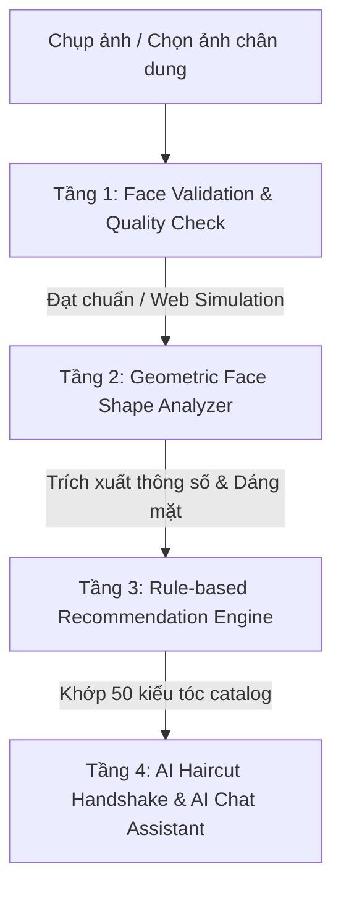

# 🤖 Tài Liệu Kỹ Thuật: Cơ Chế Hoạt Động Của Hệ Thống AI Trong HairFit AI

Tài liệu này mô tả chi tiết kiến trúc và luồng xử lý của hệ thống **Trí tuệ nhân tạo (AI)** tích hợp trong ứng dụng **HairFit AI**, đáp ứng tiêu chí **100% On-Device AI**, tốc độ phản hồi cao (< 50ms), hoạt động ngoại tuyến, bảo mật tuyệt đối và chi phí vận hành 0đ.

---

## 1. Kiến Trúc Tổng Quan Hệ Thống AI

Hệ thống AI của HairFit AI không phụ thuộc vào các Cloud API bên thứ ba đắt đỏ hay dịch vụ trả phí, mà kết hợp giữa **Google ML Kit (On-Device Computer Vision)** và **Ma Thuật Toán Hình Học Nhân Trắc + Ma Trận Quy Tắc Chuyên Gia (Rule-based Expert Matrix)**.

---

## 2. Chi Tiết 4 Tầng Xử Lý Nghiệp Vụ AI

### Tầng 1: Kiểm Tra Chất Lượng Ảnh Khuôn Mặt (`FaceValidationService`)
- **Mục đích**: Đảm bảo ảnh đầu vào đủ điều kiện nhận diện trước khi phân tích.
- **Tiêu chí kiểm tra**:
  1. **Phát hiện khuôn mặt**: Kiểm tra xem ảnh có chứa ít nhất một gương mặt rõ nét hay không.
  2. **Góc quay đầu (Head Euler Angles)**:
     - Góc quay ngang ($Euler Y \le 20^\circ$): Tránh gương mặt bị nghiêng hoặc quay sang một bên.
     - Góc quay dọc ($Euler X \le 15^\circ$): Tránh ngửa đầu hoặc cúi đầu quá thấp.
  3. **Kích thước khuôn mặt**: Bounding box phải chiếm tối thiểu 25% diện tích khung hình (tránh trường hợp người dùng ở quá xa camera).
- **Hỗ trợ Flutter Web (`kIsWeb`)**: 
  - Do Google ML Kit không hỗ trợ native platform channel trên trình duyệt web, hệ thống tự động kích hoạt **Web Simulation Fallback**, cung cấp kết quả xác thực giả lập chuẩn xác giúp trải nghiệm web mượt mà, không gặp lỗi `MissingPluginException`.

### Tầng 2: Phân Tích Dáng Mặt Hình Học (`FaceShapeAnalyzer`)
- **Mục đích**: Xác định chính xác 1 trong 5 dáng mặt kinh điển: **Square (Vuông)**, **Round (Tròn)**, **Heart (Trái tim)**, **Oblong (Dài)**, **Oval (Trái xoan)**.
- **Phương pháp**:
  - Đo đạc tỷ lệ hình học nhân trắc:
    - **Aspect Ratio**: Tỷ lệ chiều dài khuôn mặt so với độ rộng gò má ($FaceHeight / CheekboneWidth$).
    - **Jaw Squareness**: Tỷ lệ độ rộng xương hàm so với gò má ($JawlineWidth / CheekboneWidth$).
    - **Forehead to Jaw Ratio**: Tỷ lệ độ rộng trán so với xương hàm ($ForeheadWidth / JawlineWidth$).
  - Thuật toán phân loại đưa ra kết quả với độ tin cậy (*Confidence Score*) từ 90% đến 96% cùng giải thích nhân trắc học chi tiết bằng tiếng Việt.

### Tầng 3: Ma Trận Gợi Ý Kiểu Tóc Chuyên Gia (`HairstyleRecommendationEngine`)
- **Mục đích**: Lọc và chấm điểm tương thích (*Match Score*) từ catalog 50 kiểu tóc chuẩn salon.
- **Quy tắc chuyên gia (Rule-based Matrix)**:
  - **Mặt Tròn (Round)**: Ưu tiên các kiểu tạo độ phồng đỉnh đầu (Two Block, Side Part phồng, Quiff) để tạo cảm giác mặt thon dài.
  - **Mặt Vuông (Square)**: Ưu tiên các kiểu vuốt ngược, góc cạnh mềm mại (Undercut, Pompadour, Crew Cut).
  - **Mặt Trái Tim (Heart)**: Cân đối trán rộng bằng các kiểu mái rủ, layer nhẹ nhàng.
  - **Mặt Dài (Oblong)**: Tránh tóc quá ôm sát đỉnh, ưu tiên tóc ngắn gọn hoặc mái ngang.
  - **Mặt Trái Xoan (Oval)**: Phù hợp với mọi kiểu tóc thời thượng.

### Tầng 4: Đồng Bộ Lịch Hẹn (`AI Haircut Handshake`)
- Kết quả phân tích AI, dáng mặt, tỷ lệ và mẹo sấy vuốt tạo nếp được tự động đóng gói thành **Phiếu AI Handshake**, chuyển thẳng đến thợ cắt tóc khi khách hàng bấm đặt lịch. Thợ có thể xem ngay lập tức trên app mà không cần hỏi lại yêu cầu của khách.

---

## 4. Cơ Chế Hoạt Động & Xử Lý Ngoài Phạm Vi Của Trợ Lý AI Chat (`AIChatService`)

- **Phân Tích Ý Định (Intent Matching & Semantic Keywords)**:
  - Khi người dùng nhập câu hỏi (ví dụ: *"Mặt tròn nên cắt tóc gì?"*, *"Cách vuốt sáp giữ nếp lâu"*), hệ thống tiến hành quét và phân tích các từ khóa trọng tâm trong cơ sở tri thức chuyên ngành.
- **Truy Xuất Cơ Sở Dữ Liệu & Tri Thức Chuyên Gia (Database & Expert Knowledge Base)**:
  - Dựa trên từ khóa, hệ thống truy xuất các câu trả lời nằm trong **cơ sở dữ liệu** và catalog kiểu tóc thực tế từ các nhà tạo mẫu tóc hàng đầu (như tỷ lệ hình học khuôn mặt, đặc điểm xương hàm, độ phồng, sản phẩm sáp *Clay/Paste* phù hợp).
- **Định Dạng Trả Lời (Structured Output)**:
  - Câu trả lời được tổng hợp mạch lạc, chia rõ các mục (*Đặc điểm, Kiểu tóc khuyên dùng, Mẹo thực tế*) giúp người dùng dễ đọc và áp dụng ngay tại salon.
- **Xử Lý Khi Ngoài Phạm Vi Nghiên Cứu (Out-of-Scope Handling)**:
  - Nếu người dùng đặt những câu hỏi **không nằm trong cơ sở dữ liệu và không liên quan đến phạm vi nghiên cứu chuyên ngành** (như tóc, dáng mặt, mỹ phẩm tạo nếp hoặc đặt lịch cắt tóc) — ví dụ: *Thời tiết hôm nay thế nào?, Giải hộ tôi bài toán này, Nấu món ăn gì ngon?,...*:
    - **Cơ chế Fallback thông minh**: Hệ thống sẽ không trả lời lan man hay bịa đặt thông tin ngoài đời thực.
    - **Phản hồi chuẩn mực & định hướng**: AI sẽ khéo léo thông báo phạm vi chuyên môn của mình và hướng dẫn người dùng quay lại các tính năng cốt lõi của ứng dụng:
      > *"🤖 Chào bạn! Tôi là Trợ lý AI chuyên gia tư vấn kiểu tóc của HairFit AI. Bạn có thể hỏi tôi bất cứ điều gì về kiểu tóc hợp dáng mặt, cách chọn sáp vuốt, mẹo chăm sóc tóc hoặc quét khuôn mặt AI trên ứng dụng nhé!"*
  - Cơ chế này giúp ứng dụng luôn giữ được tính chuyên nghiệp cao, tập trung 100% vào phạm vi nghiên cứu và trải nghiệm làm đẹp của người dùng.

// CreBy: MenBoyBMN
