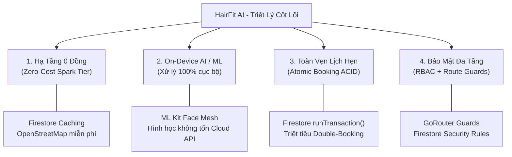
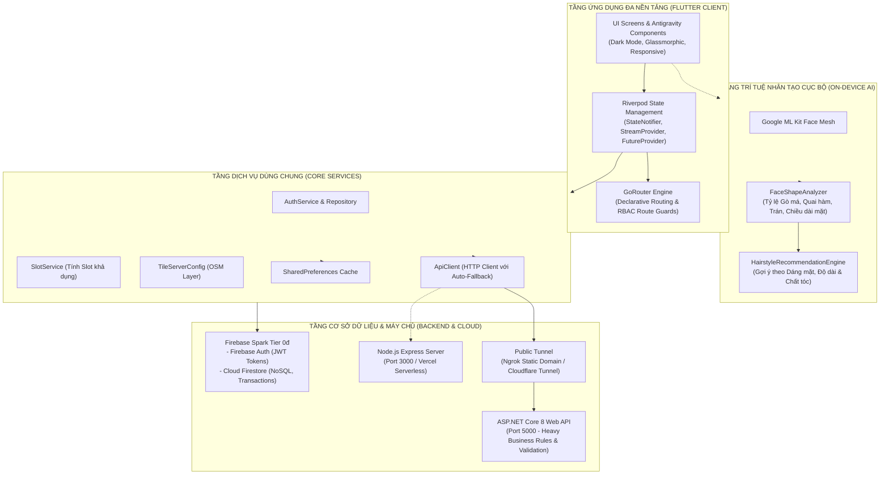
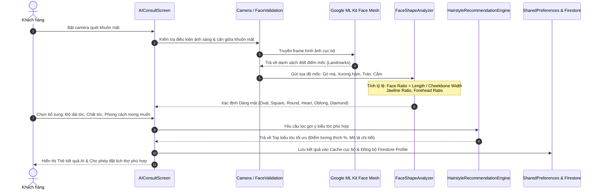
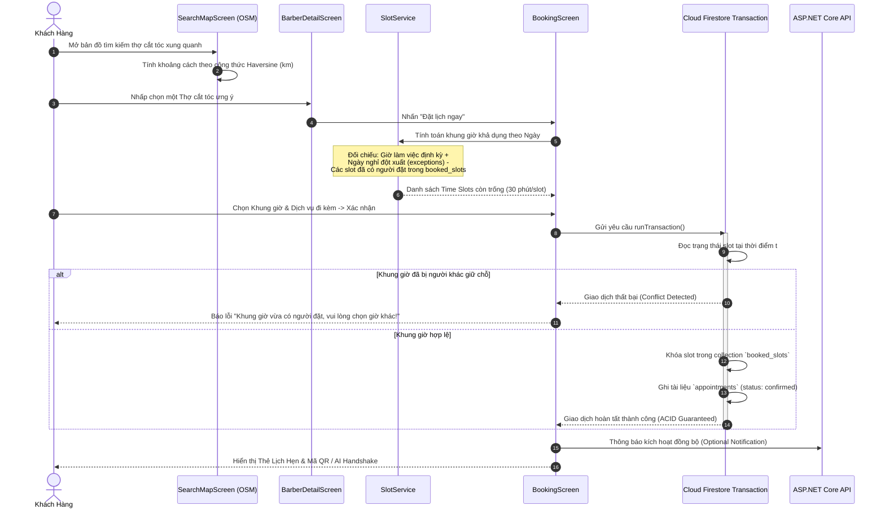
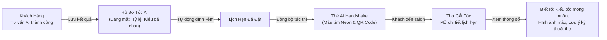
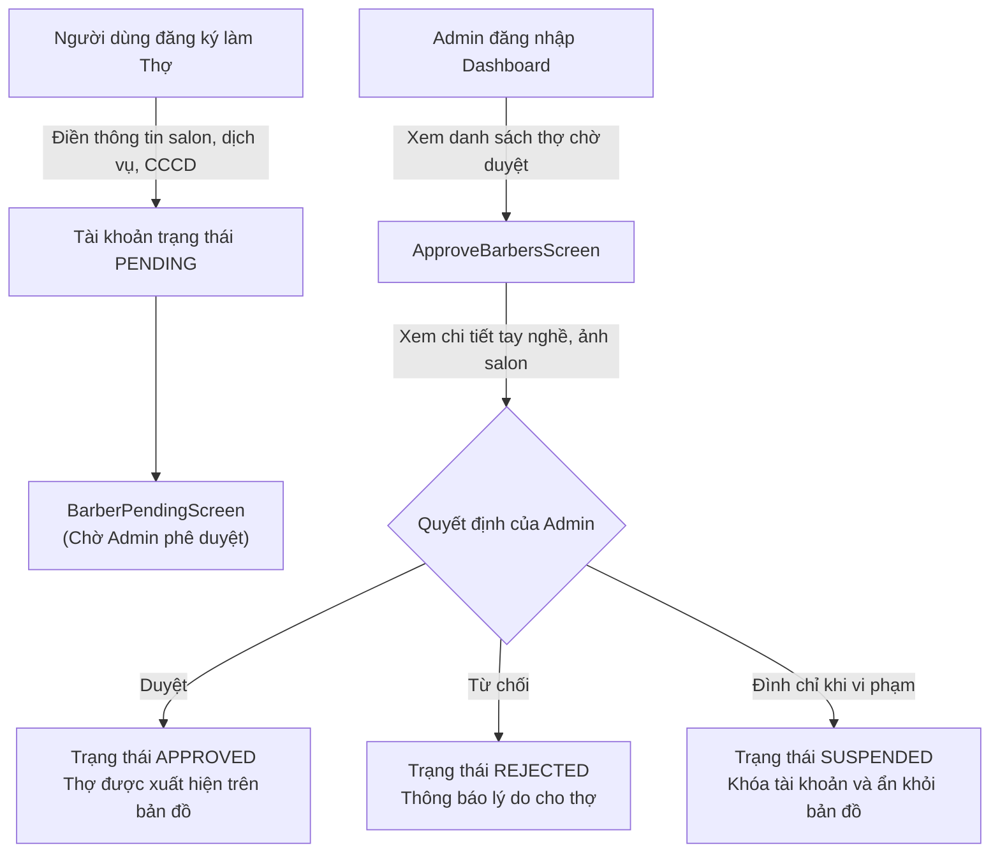

# HairFit AI - Kiến Trúc Hệ Thống & Cơ Chế Hoạt Động (Architecture & Workflows)

Tài liệu này phân tích chuyên sâu về kiến trúc phần mềm, nguyên tắc thiết kế bất biến, sơ đồ luồng dữ liệu (data flow) và các quy trình nghiệp vụ cốt lõi (end-to-end workflows) vận hành nền tảng **HairFit AI**.

---

## 1. Triết Lý Thiết Kế & Các Nguyên Tắc Kiến Trúc Bất Biến (Architectural Invariants)

HairFit AI được kiến tạo dựa trên 4 trụ cột kiến trúc cốt lõi:



1. **Hạ Tầng 0 Đồng (Zero-Cost Infrastructure)**:
   - Ứng dụng được thiết kế tối ưu hóa nghiêm ngặt để vận hành bền vững trong giới hạn miễn phí của **Firebase Spark Tier (0đ)** (50,000 lượt đọc và 20,000 lượt ghi Firestore mỗi ngày).
   - Bản đồ sử dụng **OpenStreetMap** thông qua bộ điều phối `TileServerConfig` chuẩn hóa User-Agent và bộ nhớ đệm hình ảnh, loại bỏ 100% chi phí bản quyền Google Maps Platform API.
2. **Trí Tuệ Nhân Tạo Trên Thiết Bị (On-Device AI Engine)**:
   - **Tuyệt đối không gửi ảnh người dùng lên Cloud API trả phí** (như Google Cloud Vision, Azure Cognitive Services hay OpenAI Vision).
   - Nhận diện khuôn mặt và trích xuất điểm mốc (landmarks) diễn ra trực tiếp trên phần cứng thiết bị thông qua **Google ML Kit Face Mesh Detection**. Phân loại dáng mặt được tính toán bằng các công thức toán học - hình học giải tích (Euclidean Distance & Aspect Ratios), bảo vệ quyền riêng tư tuyệt đối cho người dùng.
3. **Tính Toàn Vẹn Giao Dịch Đặt Lịch (Atomic Booking Integrity)**:
   - Không cho phép xảy ra hiện tượng đặt trùng lịch (double-booking) khi nhiều khách hàng cùng chọn một khung giờ. Mọi thao tác đặt chỗ đều được bọc trong giao dịch nguyên tử `FirebaseFirestore.instance.runTransaction()` và xác thực chéo với máy chủ Backend.
4. **Kiểm Soát Phân Quyền Đa Tầng (RBAC - Role-Based Access Control)**:
   - Phân định rõ 3 vai trò: `customer` (Khách hàng), `barber` (Thợ cắt tóc), `admin` (Quản trị viên hệ thống).
   - Cơ chế bảo vệ 2 lớp: Route Guards tại tầng định tuyến (`GoRouter`) và Security Rules tại tầng cơ sở dữ liệu (`Firestore Security Rules`).

---

## 2. Sơ Đồ Kiến Trúc Hệ Thống Tổng Thể (System Architecture)



---

## 3. Cấu Trúc Mã Nguồn Theo Tính Năng (Feature-First Directory Structure)

Mã nguồn tuân thủ kiến trúc phân rã theo miền nghiệp vụ (**Feature-First**), giúp dự án mở rộng module độc lập mà không gây xung đột phụ thuộc chéo:

```text
frontend/lib/
├── core/                                # Nền tảng dùng chung toàn hệ thống
│   ├── constants/                       # AppColors, AppDimensions, AppTextStyles, BusinessConstants
│   ├── services/                        # ApiClient, FirebaseService, LocationService, TileServerConfig, SeedDataService
│   ├── theme/                           # AppTheme (Dark Mode chuẩn Material 3)
│   ├── utils/                           # PlatformHelper, DateFormatter, DistanceHelper, Validators
│   └── widgets/                         # AntigravityCard, StaggeredReveal, WebNavShell, AppButton, StatusBadge,...
├── features/                            # Các phân hệ nghiệp vụ độc lập
│   ├── admin/                           # Cổng Quản Trị: Thống kê sàn, Phê duyệt thợ, Quản lý người dùng, Đánh giá
│   ├── ai_consult/                      # AI Tư Vấn: Quét camera Face Mesh, phân tích tỷ lệ, gợi ý 50 kiểu tóc
│   ├── appointments/                    # Quản lý Lịch hẹn: Khách xem lịch, Thẻ AI Handshake, Thợ xem doanh thu
│   ├── auth/                            # Xác thực: Đăng nhập, Đăng ký, Quên mật khẩu, Splash phân quyền
│   ├── barber_profile/                  # Hồ sơ Thợ: Cấu hình giờ làm việc, ngày nghỉ đột xuất, bảng giá dịch vụ
│   ├── booking/                         # Đặt Lịch Hẹn: Thuật toán tính slot, tóm tắt đặt chỗ, giao dịch Firestore
│   ├── chat/                            # Trò chuyện trực tuyến giữa Khách và Thợ thời gian thực
│   ├── home/                            # Trang chủ Khách hàng: Lịch sắp tới, Hồ sơ tóc AI, Salon nổi bật
│   ├── profile/                         # Thông tin tài khoản cá nhân, đổi mật khẩu, đăng xuất
│   └── search_map/                      # Bản đồ OpenStreetMap, định vị GPS, tìm kiếm và lọc thợ cắt tóc
├── models/                              # Data Models bất biến (copyWith, fromMap, toMap)
├── providers/                           # Riverpod State Providers điều phối trạng thái ứng dụng
└── routing/                             # Cấu hình GoRouter, danh sách routes và RBAC Redirect Guards
```

---

## 4. Các Quy Trình Nghiệp Vụ Cốt Lõi (Core Workflows)

### 4.1 Quy Trình 1: AI Tư Vấn Kiểu Tóc & Phân Tích Dáng Mặt On-Device

Quy trình nhận diện và phân tích tỷ lệ khuôn mặt diễn ra hoàn toàn trên thiết bị (On-Device), bảo mật thông tin và phản hồi ngay lập tức:



#### Thuật Toán Phân Loại Dáng Mặt (Geometric Rules):
1. **Mặt Tròn (Round)**: Tỷ lệ Chiều dài / Chiều rộng gò má $\approx 1.0 - 1.15$, góc xương hàm bo tròn mềm mại.
2. **Mặt Vuông (Square)**: Tỷ lệ Chiều dài / Chiều rộng $\approx 1.0 - 1.2$, độ rộng xương hàm gần bằng độ rộng gò má, góc hàm sắc cạnh.
3. **Mặt Trái Xoan (Oval)**: Chiều dài lớn hơn chiều rộng ($\approx 1.3 - 1.5$), trán hơi rộng hơn hàm, đường viền mềm mại (Dáng mặt tiêu chuẩn hợp hầu hết kiểu tóc).
4. **Mặt Dài (Oblong)**: Chiều dài vượt trội so với chiều rộng ($> 1.5$), tỷ lệ trán và hàm tương đồng.
5. **Mặt Trái Tim (Heart)**: Trán rộng, gò má cao và thon dần về cằm nhọn.
6. **Mặt Kim Cương (Diamond)**: Gò má là phần rộng nhất, trán và cằm hẹp.

> [!TIP]
> **Chế Độ Fallback (Manual Select)**: Khi chạy trên môi trường không có Camera (như Desktop, Web không hỗ trợ, hoặc người dùng từ chối quyền Camera), ứng dụng tự động cung cấp tính năng **Trắc nghiệm hình thái học thủ công** để người dùng tự chọn dáng mặt và vẫn nhận được đầy đủ kết quả tư vấn AI.

---

### 4.2 Quy Trình 2: Khám Phá Bản Đồ & Đặt Lịch Hẹn Không Trùng Lặp (Atomic Booking)



---

### 4.3 Quy Trình 3: Thẻ Đồng Bộ Kiểu Tóc AI Handshake Giữa Khách & Thợ

Một điểm sáng tạo độc bản của HairFit AI là tính năng **AI Handshake** nhằm loại bỏ tình trạng "Cắt không đúng ý khách":



#### Vòng Đời Trạng Thái Lịch Hẹn (Appointment Lifecycle):
1. `pending`: Đang chờ xác nhận từ salon (nếu thợ bật chế độ duyệt tay).
2. `confirmed`: Đã xác nhận giữ chỗ thành công.
3. `in_progress`: Khách đã đến salon và đang cắt tóc.
4. `completed`: Dịch vụ hoàn tất, khách hàng có thể chấm điểm và viết đánh giá (Reviews & Rating Stars).
5. `cancelled`: Lịch hẹn bị hủy (giải phóng slot ngay lập tức trong `booked_slots`).
6. `no_show`: Khách không đến đúng giờ hẹn.

---

### 4.4 Quy Trình 4: Vận Hành Phân Quyền & Phê Duyệt Hồ Sơ (Barber & Admin Hub)



---

## 5. Ngăn Xếp Công Nghệ Tích Hợp Chi Tiết (Technology Stack)

| Hạng mục | Công nghệ | Lý do lựa chọn & Lợi thế kiến trúc |
| :--- | :--- | :--- |
| **Framework** | Flutter 3.x / Dart 3.x | Đơn nguồn mã (Single codebase) biên dịch mượt mà ra Android APK, Web PWA và Windows Desktop. Hỗ trợ Material 3 Dark Mode tuyệt đẹp. |
| **State Management** | Riverpod 2.5.1 | Quản lý trạng thái kiểu Declarative, an toàn kiểu dữ liệu (compile-time safety), hỗ trợ `StreamProvider.autoDispose` giúp tự giải phóng bộ nhớ và giảm lượt đọc Firestore. |
| **Routing** | GoRouter 14.x | Điều hướng bằng URL tường minh, tích hợp sẵn Route Guards để kiểm tra đăng nhập và phân quyền RBAC tức thì trước khi vào màn hình. |
| **Database & Auth** | Firebase Spark 0đ | Serverless NoSQL Database với Firestore (thời gian thực, hỗ trợ giao dịch ACID) và Firebase Auth (JWT Tokens). Miễn phí trọn đời cho tải vừa và nhỏ. |
| **On-Device Vision** | Google ML Kit Face Mesh | Trích xuất 468 điểm tọa độ 3D khuôn mặt trực tiếp bằng NPU/CPU của điện thoại, 0 đồng chi phí server, bảo mật hình ảnh cá nhân. |
| **Interactive Map** | FlutterMap & OpenStreetMap | Hiển thị bản đồ mượt mà, định vị GPS, vẽ Marker và tính khoảng cách Haversine mà không cần mua API Key Google Maps đắt đỏ. |
| **Web API Backend** | ASP.NET Core 8 Web API | Đảm nhận các nghiệp vụ phức tạp, cung cấp RESTful endpoints chuẩn hóa, hỗ trợ tích hợp với hệ thống kế toán hoặc cổng thanh toán bên thứ ba. |
| **Lightweight API** | Node.js Express Server | Máy chủ REST API dự phòng siêu nhẹ, phục vụ deploy nhanh lên Vercel Serverless để demo trực tuyến. |
| **Network Tunnel** | Ngrok & Cloudflare Tunnel | Cấp phát tên miền tĩnh HTTPS miễn phí để kết nối an toàn từ điện thoại ngoài thực địa vào máy chủ phát triển cục bộ. |

---

## 6. Chiến Lược Caching & Tối Ưu Chi Phí 0 Đồng (Zero-Cost Optimization)

1. **Bộ nhớ đệm danh mục kiểu tóc (Hairstyles Caching)**:
   - 50 kiểu tóc chuẩn AI được lưu cố định trong bộ nhớ cục bộ `SharedPreferences` và nạp vào State một lần duy nhất khi mở app. Ứng dụng không cần đọc lại collection `hairstyles` trong mỗi lần mở màn hình tư vấn.
2. **Hồ sơ dáng mặt cá nhân (Face Shape Cache)**:
   - Dáng mặt sau khi đo đạc được lưu tại máy của khách. Khi người dùng vào lại app, thẻ "Hồ Sơ Tóc Của Tôi" trên trang chủ hiển thị ngay lập tức mà không tốn bất kỳ lượt đọc cơ sở dữ liệu nào.
3. **Phân tách Sub-collections để tối ưu hóa truy vấn**:
   - Thay vì tải toàn bộ dữ liệu của một Barber khổng lồ, hệ thống phân tách:
     - `barbers/{barberId}`: Chứa thông tin cơ bản để hiển thị trên thẻ bản đồ.
     - `barbers/{barberId}/services`: Chỉ tải khi khách bấm vào chi tiết thợ.
     - `barbers/{barberId}/reviews`: Tải phân trang theo nhu cầu đọc của khách.
4. **StreamProvider tự hủy (autoDispose)**:
   - Mọi Stream lắng nghe dữ liệu thời gian thực từ Firestore đều được gắn đuôi `.autoDispose`. Khi người dùng rời khỏi màn hình, Stream listener lập tức bị ngắt kết nối, bảo toàn hạn ngạch 50,000 lượt đọc miễn phí/ngày của Firebase.

---

<!-- CreBy: MenBoyBMN -->

