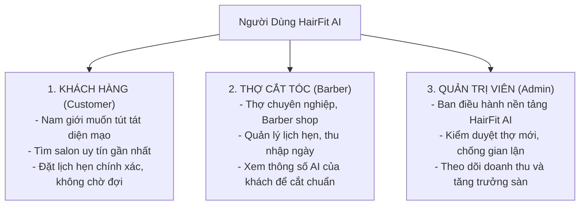
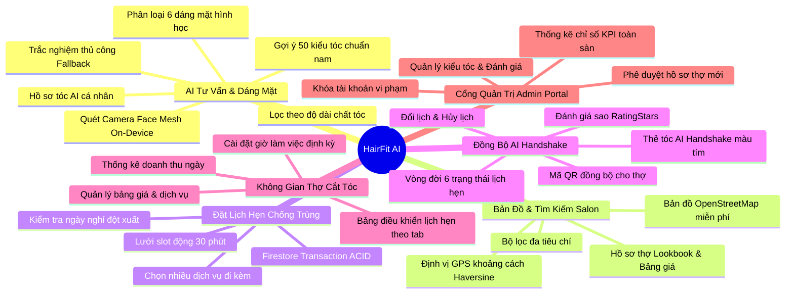
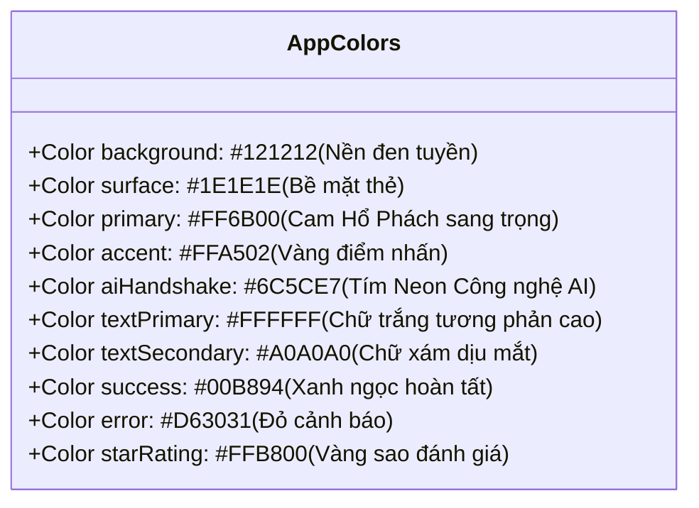

# HairFit AI - Tổng Quan Dự Án & Danh Mục Tính Năng (Project Overview & Feature Catalog)

Tài liệu này cung cấp bức tranh toàn cảnh về nền tảng **HairFit AI**: bối cảnh giải quyết bài toán, ma trận đối tượng người dùng, danh mục toàn bộ tính năng theo phân hệ nghiệp vụ, hệ thống ngôn ngữ thiết kế (Design System) và các chỉ số chất lượng kỹ thuật của ứng dụng.

---

## 1. Giới Thiệu Dự Án HairFit AI

### 1.1 Bối Cảnh Thực Tế & Bài Toán Ngành Tóc Nam
Trong đời sống hiện đại, nhu cầu chăm sóc ngoại hình của nam giới ngày càng tăng cao. Tuy nhiên, phần lớn nam giới vẫn gặp phải những trở ngại phổ biến:
1. **"Không biết mình hợp kiểu tóc nào"**: Khách hàng thường chọn kiểu tóc theo trào lưu trên mạng xã hội (Mullet, Side Part, Undercut...) nhưng khi cắt xong lại không hợp với tỷ lệ khuôn mặt thực tế, dẫn đến tự ti.
2. **"Nói một đằng, thợ cắt một nẻo"**: Khách hàng gặp khó khăn trong việc diễn đạt mong muốn kỹ thuật (độ dài đỉnh đầu, độ mờ fade hai bên...), dẫn đến sự lệch pha giao tiếp với thợ cắt tóc.
3. **Chờ đợi mất thời gian**: Khách hàng đến salon vào giờ cao điểm phải ngồi chờ từ 30 phút đến 1 tiếng, hoặc gọi điện đặt lịch thủ công dễ bị trùng giờ hoặc quên hẹn.
4. **Quản trị thủ công ở phía Salon**: Các thợ cắt tóc truyền thống ghi chép lịch hẹn bằng sổ tay hoặc tin nhắn rời rạc, không theo dõi được doanh thu ngày và không lưu trữ được lịch sử phong cách tóc của từng khách quen.

### 1.2 Giải Pháp Của HairFit AI
**HairFit AI** là hệ sinh thái di động thông minh tất-cả-trong-một (All-in-One), kết nối khách hàng với các salon/thợ cắt tóc chuyên nghiệp. Điểm đột phá của HairFit AI nằm ở việc **tích hợp công nghệ Thị giác Máy tính On-Device** để đo đạc tỷ lệ khuôn mặt và tư vấn kiểu tóc chuẩn xác ngay trên điện thoại của khách, đồng thời phát hành **Thẻ Tóc AI Handshake** giúp thợ cắt tóc nắm bắt 100% thông số kỹ thuật mong muốn của khách chỉ trong 3 giây. Toàn bộ nền tảng vận hành trên hạ tầng **0 đồng chi phí (Zero-Cost Spark Tier)**.

---

## 2. Ma Trận Đối Tượng Người Dùng & 3 Vai Trò Hệ Thống (RBAC)

Hệ thống phân quyền nghiêm ngặt 3 vai trò với trải nghiệm người dùng hoàn toàn khác biệt:

| Tiêu chí | Khách Hàng (Customer) | Thợ Cắt Tóc (Barber) | Quản Trị Viên (Admin) |
| :--- | :--- | :--- | :--- |
| **Mục tiêu chính** | Tìm kiểu tóc hợp dáng mặt & đặt lịch salon | Quản lý lịch hẹn, lấp đầy slot trống, xem doanh thu | Duyệt thợ, giám sát chất lượng và vận hành sàn |
| **Màn hình chính** | `CustomerHomeScreen` (`/home`) | `BarberAppointmentsScreen` (`/barber/appointments`) | `AdminDashboardScreen` (`/admin/dashboard`) |
| **Quyền truy cập** | Quét mặt AI, tìm salon trên bản đồ, đặt lịch, chat, đánh giá | Đổi trạng thái lịch, sửa giờ làm việc, cập nhật bảng giá dịch vụ | Duyệt/khóa thợ, xem thống kê doanh thu toàn sàn, quản trị user |

---

## 3. Danh Mục Chi Tiết Toàn Bộ Tính Năng Theo Phân Hệ

---

### Phân Hệ 1: AI Tư Vấn Kiểu Tóc & Phân Tích Hình Thái Học (AI Consult)
1. **Camera Quét Lưới Khuôn Mặt On-Device**: Sử dụng Google ML Kit Face Mesh trích xuất 468 điểm tọa độ 3D trên khuôn mặt trong thời gian thực.
2. **Thuật Toán Phân Loại Dáng Mặt Hình Học (`FaceShapeAnalyzer`)**:
   - Tự động đo đạc tỷ lệ giữa: Chiều dài mặt, Độ rộng xương gò má, Độ rộng cung xương quai hàm và Độ rộng trán.
   - Nhận diện chính xác 6 dáng mặt nam giới điển hình: **Mặt Tròn (Round), Mặt Vuông (Square), Mặt Trái Xoan (Oval), Mặt Dài (Oblong), Mặt Trái Tim (Heart), Mặt Kim Cương (Diamond)**.
3. **Bộ Động Cơ Gợi Ý Kiểu Tóc (`HairstyleRecommendationEngine`)**:
   - Kho dữ liệu chuẩn gồm **50 kiểu tóc nam kinh điển & hiện đại** (Side Part 7/3, Pompadour, Ivy League, Buzz Cut, French Crop, Mullet, Two Block, Layer Hàn Quốc, Dreadlocks...).
   - Tính toán điểm số tương thích (Compatibility Score %) giữa đặc điểm hình học của người dùng với cấu trúc từng kiểu tóc.
4. **Bộ Lọc Nâng Cao Theo Cá Nhân Hóa**: Người dùng có thể tùy chỉnh thêm:
   - *Độ dài tóc hiện tại*: Tóc ngắn (Short), Tóc vừa (Medium), Tóc dài (Long).
   - *Chất tóc*: Tóc thẳng (Straight), Tóc gợn sóng (Wavy), Tóc xoăn (Curly), Tóc sợi cứng hoặc sợi mảnh.
   - *Môi trường làm việc*: Công sở chỉn chu, Học sinh/Sinh viên trẻ trung, Nghệ sĩ phá cách.
5. **Chế Độ Trắc Nghiệm Hình Thái Học Thủ Công (Manual Select Fallback)**:
   - Hỗ trợ toàn diện khi người dùng sử dụng thiết bị không có camera (máy tính để bàn Windows, trình duyệt Web) hoặc môi trường thiếu sáng: Người dùng trả lời 3 câu hỏi trắc nghiệm trực quan để hệ thống suy luận dáng mặt và trả về kết quả gợi ý tương đương.
6. **Thẻ Hồ Sơ Tóc Của Tôi (`MyAiHairProfileCard`)**: Lưu trữ vĩnh viễn kết quả dáng mặt trên trang chủ, cho phép xem lại và đổi phong cách bất cứ lúc nào mà không cần quét lại.

---

### Phân Hệ 2: Khám Phá & Bản Đồ Salon / Thợ Cắt Tóc (Search & Interactive Map)
1. **Bản Đồ Tương Tác OpenStreetMap**:
   - Tích hợp qua `flutter_map` kết hợp `TileServerConfig` tối ưu bộ nhớ đệm, chạy mượt mà trên cả Mobile và Web, không phụ thuộc Google Maps API.
2. **Định Vị Vị Trí Hiện Tại (GPS)**:
   - Xác định tọa độ người dùng thông qua `geolocator` và tính toán khoảng cách thực tế đến từng salon theo công thức toán học **Haversine** (hiển thị chính xác dạng `0.8 km`, `2.4 km`).
3. **Bộ Lọc Đa Tiêu Chí**:
   - Tìm kiếm tức thời theo: Tên thợ, Tên salon, Địa chỉ đường phố.
   - Lọc nhanh: Gần tôi nhất, Đánh giá cao nhất (4.5★ - 5★), Mức giá dịch vụ.
4. **Hồ Sơ Chi Tiết Của Thợ Cắt Tóc (`BarberDetailScreen`)**:
   - Tên thợ, địa chỉ salon, số điện thoại, ảnh đại diện.
   - Album ảnh tác phẩm thực tế (Lookbook Portfolio).
   - Giờ làm việc trong tuần và thông báo trạng thái nhận khách hôm nay.
   - Danh sách các dịch vụ kèm đơn giá rõ ràng (Cắt tóc tạo kiểu, Combo cạo mặt ráy tai, Uốn textured, Nhuộm tẩy...).
   - Đánh giá sao và nhận xét từ những khách hàng đã sử dụng dịch vụ.

---

### Phân Hệ 3: Đặt Lịch Hẹn Thông Minh Chống Trùng Lặp (Smart Booking Engine)
1. **Chọn Ngày & Lưới Khung Giờ Động (Time Slot Grid)**:
   - Hiển thị lịch 14 ngày tới.
   - Lưới slot 30 phút/khung giờ tự động tính toán dựa trên: Giờ mở - đóng cửa của thợ, trừ đi các khoảng nghỉ trưa, ngày nghỉ đột xuất và các slot đã được đặt trước.
2. **Giao Dịch Đặt Lịch Nguyên Tử (Atomic Booking Integrity)**:
   - Thao tác khóa lịch vận hành bằng `FirebaseFirestore.instance.runTransaction()`. Nếu có 2 khách hàng bấm đặt cùng 1 giây, hệ thống sẽ chỉ chấp nhận giao dịch đến trước, người đến sau nhận thông báo đổi giờ lịch sự, triệt tiêu hoàn toàn rủi ro trùng lịch (double-booking).
3. **Chọn Nhiều Dịch Vụ Cùng Lúc**: Khách có thể chọn đồng thời Cắt + Gội + Uốn; hệ thống tự động cộng dồn tổng thời lượng và tính tổng số tiền thanh toán minh bạch.
4. **Tóm Tắt Đặt Chỗ (Booking Summary)**: Hiển thị đầy đủ thông tin trước khi nhấn xác nhận: Tên thợ, Thời gian, Dịch vụ đã chọn, Địa chỉ salon và Tổng tiền.

---

### Phân Hệ 4: Quản Lý Lịch Hẹn & Thẻ Đồng Bộ Tóc AI Handshake
1. **Thẻ Đồng Bộ AI Handshake Độc Quyền**:
   - Khi khách hàng đã có kết quả tư vấn AI, lịch hẹn sẽ tự động đính kèm **Thẻ AI Handshake** màu tím sang trọng.
   - Thẻ thể hiện: Dáng mặt khách, Kiểu tóc đã chọn, Tỷ lệ khuôn mặt, Ảnh mẫu 360° và các ghi chú kỹ thuật dành riêng cho thợ (ví dụ: *"Cần tỉa mỏng đỉnh đầu, hai bên cạo fade thấp để che bớt khuyết điểm quai hàm rộng"*).
   - Trang bị mã QR để thợ quét nhanh khi khách bước vào quán.
2. **Quản Lý Vòng Đời Lịch Hẹn (Customer Appointments)**:
   - Xem danh sách lịch hẹn: Tab "Sắp tới" và "Lịch sử".
   - Hỗ trợ đổi giờ hẹn (Reschedule) và hủy lịch hẹn linh hoạt kèm giải phóng slot tức thời.
3. **Đánh Giá & Nhận Xét Sau Dịch Vụ**:
   - Sau khi lịch hẹn chuyển sang trạng thái `completed`, khách hàng có thể chấm điểm sao (1 đến 5 sao với widget `RatingStars`) và gửi cảm nghĩ về tay nghề của thợ.

---

### Phân Hệ 5: Không Gian Dành Cho Thợ Cắt Tóc (Barber Workplace)
1. **Màn Hình Lịch Hẹn Chuyên Biệt (`BarberAppointmentsScreen`)**:
   - Phân loại lịch hẹn thành 3 tab rõ ràng: **Hôm nay (Today)**, **Chờ duyệt (Pending)**, **Đã hoàn thành (History)**.
   - Thao tác chuyển đổi trạng thái nhanh: Nhận khách (`in_progress`), Hoàn thành (`completed`), Hủy (`cancelled`).
2. **Bảng Thống Kê Thu Nhập Ngày (`BarberDailyEarnings`)**:
   - Hiển thị trực quan ngay đầu ngày: Tổng số khách đặt, số cuốc cắt đã hoàn thành, tổng doanh thu thực nhận trong ngày (VNĐ).
3. **Quản Lý Giờ Làm Việc Định Kỳ (`WorkingHoursEditor`)**:
   - Cài đặt giờ mở cửa, giờ đóng cửa riêng cho từng ngày từ Thứ Hai đến Chủ Nhật.
   - Bật/tắt trạng thái nhận khách nhanh (`isAcceptingBookingsToday`).
4. **Quản Lý Danh Mục Dịch Vụ & Bảng Giá (`ServiceEditor`)**:
   - Tự do thêm, sửa, xóa các gói dịch vụ, giá tiền và thời lượng thực hiện (phút).

---

### Phân Hệ 6: Cổng Quản Trị Hệ Thống (Admin Control Hub)
1. **Bảng Điều Khiển Tổng Quan Sàn (`AdminDashboardScreen`)**:
   - Thống kê thời gian thực: Tổng số người dùng, Tổng số thợ cắt tóc, Số lịch hẹn thành công, Tỷ lệ hoàn thành lịch (Completion Rate), Tổng giá trị giao dịch trên toàn hệ thống.
2. **Quy Trình Phê Duyệt Hồ Sơ Thợ Mới (`ApproveBarbersScreen`)**:
   - Thợ sau khi đăng ký sẽ ở trạng thái `pending`. Admin kiểm tra thông tin salon, địa chỉ, ảnh tay nghề để bấm **Phê duyệt (Approve)** hoặc **Từ chối (Reject)**.
   - Chức năng **Đình chỉ tài khoản (Suspend)**: Ngay lập tức ẩn thợ khỏi bản đồ và khóa quyền nhận lịch nếu có khiếu nại vi phạm.
3. **Kiểm Duyệt Người Dùng & Đánh Giá**:
   - Quản lý danh sách khách hàng, theo dõi các phản hồi tiêu cực để can thiệp kịp thời bảo vệ uy tín nền tảng.

---

### Phân Hệ 7: Trò Chuyện Trực Tuyến & Thông Báo (Chat & Notifications)
1. **Nhắn Tin Khách - Thợ Thời Gian Thực (`ChatScreen`)**:
   - Trò chuyện 1-1 trực tiếp trong ứng dụng qua Firestore, hỗ trợ khách hỏi đường đi, báo đến trễ hoặc gửi ảnh tóc mong muốn.
2. **Banner Nhắc Lịch Thông Minh (`UpcomingAppointmentReminderBanner`)**:
   - Banner màu đỏ nổi bật hiển thị ở đầu trang chủ khách hàng khi có lịch hẹn trong ngày, kèm nút "Xem đường đi" và "Chi tiết lịch".
3. **Hệ Thống Thông Báo Nội Bộ (`NotificationService`)**:
   - Báo chuông nhắc nhở trước giờ hẹn và khi trạng thái lịch có sự thay đổi.

---

## 4. Hệ Thống Thiết Kế Giao Diện (Design System & Dark Mode Spec)

Giao diện HairFit AI được thiết kế theo phong cách **Gentleman Barber Lounge Dark Mode**, toát lên vẻ nam tính, cao cấp và lịch lãm:

### Các Thành Phần Giao Diện Độc Quyền (Antigravity UI Components):
1. **`AntigravityCard`**:
   - Khung thẻ hiệu ứng kính mờ (Glassmorphism) với độ mờ viền tinh tế, hỗ trợ nghiêng góc 3D tương tác theo chuyển động con trỏ chuột trên Web/Desktop.
2. **`StaggeredReveal`**:
   - Cơ chế hoạt họa xuất hiện tuần tự mượt mà theo từng tầng (staggered delay), giúp danh sách kiểu tóc và thẻ salon hiển thị sống động mà không giật lag khung hình.
3. **`WebNavShell`**:
   - Thanh điều hướng Top Navbar kính mờ gắn cố định ở cạnh trên màn hình khi chạy trên trình duyệt Web hoặc màn hình Desktop lớn, tự động điều chỉnh bố cục co giãn linh hoạt (Responsive layout).

---

## 5. Bảng Chỉ Số Chất Lượng Kỹ Thuật (Quality Benchmarks)

| Chỉ số chất lượng | Tiêu chuẩn đặt ra | Kết quả đạt được | Đánh giá |
| :--- | :--- | :--- | :--- |
| **Chi Phí Hạ Tầng** | Tối đa 0 VNĐ/tháng | **0 VNĐ (Spark Tier)** | 🌟 Đạt tuyệt đối |
| **Static Code Analysis** | 0 lỗi, 0 cảnh báo | **`No issues found!`** | 🌟 Đạt tuyệt đối |
| **Độ Bao Phủ Kiểm Thử** | 100% test cases pass | **121 / 121 Tests Pass** | 🌟 Đạt tuyệt đối |
| **Backend Unit Tests** | 100% test cases pass | **5 / 5 Tests Pass** | 🌟 Đạt tuyệt đối |
| **Độ Trễ Phân Tích AI** | Dưới 500ms | **~150ms (On-Device)** | 🌟 Siêu tốc |
| **Ngôn Ngữ Giao Diện** | 100% Tiếng Việt chuẩn mực | **100% Tiếng Việt** | 🌟 Đạt chuẩn |
| **Credit Note Bắt Buộc** | 100% file mã nguồn | **Đầy đủ `CreBy: MenBoyBMN`** | 🌟 Hoàn tất |

---

<!-- CreBy: MenBoyBMN -->

