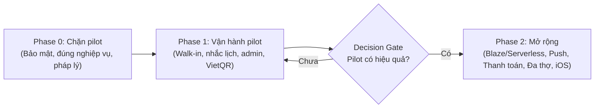
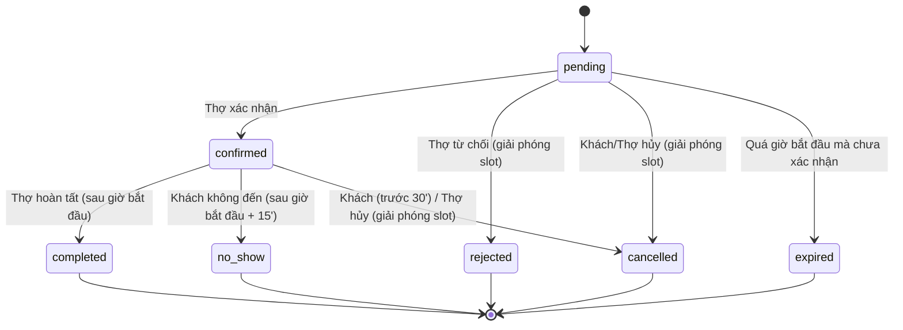

# HAIRFIT AI — ARCHITECTURE REVIEW & ROADMAP THỰC THI

> **Vai trò người viết:** Senior Solution Architect  
> **Ngày review:** 2026-10-03 · **Phiên bản code được review:** commit `0e5c903` (HairFit_AI_Ver1.0)  
> **Mục tiêu dự án (đã xác nhận với chủ dự án):** Chạy **pilot với vài salon quen**, sau đó mới phát hành rộng.  
> **Ràng buộc hạ tầng (đã xác nhận):** Giữ **Firebase Spark (miễn phí)** — chỉ dùng client + Security Rules, **không** Cloud Functions.  
> **Tính năng mở rộng mong muốn:** Push notification, đặt cọc online, iOS, salon nhiều thợ, đăng nhập Google/OTP.

> [!IMPORTANT]
> **Cập nhật 2026-10-04:** Dự án chốt hướng **chi phí 0đ**. Một số task dưới đây (P0-06, P0-09, P1-03, P1-11, P2-02, P2-04) đã được điều chỉnh hoặc thay thế bởi [HairFit_AI_Zero_Cost_Architecture.md](./HairFit_AI_Zero_Cost_Architecture.md). AI Agent **phải đọc mục 9 của tài liệu đó** trước khi thực hiện các task này.

---

## 0. HƯỚNG DẪN DÀNH CHO AI AGENT (ĐỌC TRƯỚC KHI CODE)

### 0.1 Cách dùng tài liệu này
1. Tài liệu chia thành **Task có ID** (ví dụ `P0-01`). Mỗi lần chỉ thực hiện **1 task** (hoặc 1 nhóm task được chỉ định).
2. Mỗi task có các mục cố định: **Bối cảnh/Bằng chứng → Vấn đề → Giải pháp → Các bước → File bị ảnh hưởng → Tiêu chí nghiệm thu (Acceptance Criteria) → Cách test**.
3. Làm theo **thứ tự Phase**: `Phase 0` (chặn pilot) → `Phase 1` (vận hành pilot) → `Phase 2` (Decision Gate & mở rộng). Trong một phase, tôn trọng mục **Phụ thuộc (Depends on)**.
4. Phụ lục A chứa **bản `firestore.rules` đề xuất hoàn chỉnh**. Phụ lục B chứa **mô hình dữ liệu mới**. Phụ lục C là **Definition of Done** chung.

### 0.2 Quy tắc bắt buộc khi thực thi
- **Không phá vỡ hành vi đang chạy** ngoài phạm vi task. Không refactor lan man — chỉ "dọn dẹp" file mà task đang chạm vào.
- Sau mỗi task phải chạy: `flutter analyze` (0 error), `flutter test` (pass hết). Nếu task chạm `firestore.rules` → chạy thêm bộ test rules trên Emulator (xem `P0-01`).
- Giữ nguyên comment/docstring tiếng Việt hiện có không liên quan đến thay đổi.
- Mọi chuỗi hiển thị cho người dùng: tiếng Việt. Tên biến/hàm/class: tiếng Anh.
- **Không bao giờ** đặt secret (khóa thanh toán, service account, private key) vào code Flutter hoặc `.env` được bundle vào app.
- Thời gian nghiệp vụ luôn theo **Asia/Ho_Chi_Minh** (xem `P0-03`). Không dùng `DateTime(y,m,d,h,m)` trần cho dữ liệu lưu trữ.
- Khi task thay đổi mô hình dữ liệu → cập nhật `HairFit_AI_Specification.md` mục 8 tương ứng.
- Commit message: `[<TaskID>] <mô tả ngắn>` — ví dụ `[P0-03] Fix timezone khi sinh slot & tạo appointment`.

### 0.3 Bối cảnh kỹ thuật hiện tại (tóm tắt để agent không phải dò lại)
| Hạng mục | Hiện trạng |
|---|---|
| Framework | Flutter (Dart SDK ^3.13), chỉ có thư mục `android/`, `web/`, `windows/` — **chưa có `ios/`** |
| State | Riverpod 2 (trộn lẫn `StateNotifier` cũ và `AsyncNotifier` mới) |
| Routing | GoRouter, guard theo role trong [app_router.dart](../lib/routing/app_router.dart) |
| Backend | Firebase Auth (Email/Password) + Cloud Firestore, **gói Spark** |
| AI | Google ML Kit Face Detection (contours) + rule-based engine on-device |
| Map | `flutter_map` + tile server (hiện đang dùng **Google tile không chính thức**) + Nominatim geocoding |
| Ảnh | Avatar/cover lưu **base64 trực tiếp trong document Firestore** |
| Test | 17 file test (domain, widget, provider). **Chưa có test Security Rules, chưa có integration test, chưa có CI** |

---

## 1. TÓM TẮT ĐIỀU HÀNH (EXECUTIVE SUMMARY)

### 1.1 Đánh giá tổng thể
Dự án có **nền tảng tốt cho một MVP**: cấu trúc feature-first rõ ràng, nghiệp vụ đặt lịch có Transaction chống trùng, AI on-device hợp lý về chi phí/quyền riêng tư, có unit test cho domain. Tuy nhiên **chưa sẵn sàng đưa cho salon thật dùng** vì 4 nhóm rủi ro lớn:

1. **Bảo mật dữ liệu (nghiêm trọng):** Security Rules hiện tại cho phép *bất kỳ người dùng đã đăng nhập* đọc toàn bộ lịch hẹn & tin nhắn của người khác, đổi trạng thái lịch hẹn của thợ khác, xóa slot của người khác, và tự sửa điểm rating của thợ.
2. **Tính đúng đắn nghiệp vụ:** Lỗi múi giờ (dùng giờ thiết bị), client tự xóa dữ liệu "mồ côi", rating tính không nguyên tử, không có khái niệm khách vãng lai (walk-in) → **trùng lịch ngoài đời thực**.
3. **Pháp lý / tuân thủ:** Dùng tile Google Maps không chính thức (vi phạm ToS), `applicationId = com.example...`, ký release bằng debug key, chưa có xóa tài khoản (bắt buộc trên Google Play), chưa có chính sách quyền riêng tư cho dữ liệu khuôn mặt.
4. **Vận hành:** Không có môi trường dev/prod tách biệt, không có crash reporting, màn hình test/seed (`/spike-test`) lọt vào bản build, không CI.

### 1.2 Bảng điểm (thang 5)
| Khía cạnh | Điểm | Nhận xét ngắn |
|---|:-:|---|
| Kiến trúc thư mục | 3.5 | Feature-first tốt, nhưng provider nằm lẫn `lib/providers/` và trong file data |
| Nghiệp vụ đặt lịch | 3 | Transaction đúng hướng, nhưng thiếu walk-in, no-show, hết hạn pending, sai múi giờ |
| Bảo mật (Rules) | 1.5 | Nhiều lỗ hổng đọc/ghi chéo dữ liệu |
| Toàn vẹn dữ liệu | 2 | Rating/aggregate không nguyên tử, base64 trong doc, denormalize thủ công |
| AI module | 3.5 | Nhanh, rẻ; thiếu chuẩn hóa góc nghiêng, thiếu đo độ chính xác thực tế |
| Khả năng vận hành (Ops) | 1.5 | Không env tách biệt, không crash log, không CI |
| Sẵn sàng phát hành | 1 | Package name, signing, targetSdk, xóa tài khoản, privacy policy |
| Chất lượng test | 3 | Domain test tốt; thiếu rules test & integration test |

### 1.3 Ba việc phải làm ngay (nếu chỉ có 1 tuần)
1. `P0-01` Viết lại `firestore.rules` + test trên Emulator.
2. `P0-02` + `P0-03` Sửa luồng đặt lịch cho tương thích rules mới và đúng múi giờ.
3. `P0-04` Gỡ tile Google không chính thức.

---

## 2. RÀNG BUỘC GÓI SPARK — PHẢI HIỂU TRƯỚC KHI LÊN KẾ HOẠCH

> [!IMPORTANT]
> Một số tính năng chủ dự án mong muốn **không thể làm an toàn chỉ với client + Security Rules**. Bảng dưới là căn cứ cho mục **Decision Gate (Phase 2)**.

| Tính năng | Spark được không? | Lý do | Phương án trên Spark (pilot) |
|---|:-:|---|---|
| Firestore, Auth Email, Google Sign-In | ✅ | — | Dùng bình thường |
| App Check (Play Integrity), Crashlytics, Analytics | ✅ | Miễn phí | Nên bật ngay |
| **Firebase Storage** (lưu ảnh) | ❌ | Từ 2026 bucket `*.firebasestorage.app` yêu cầu Blaze | Ảnh thumbnail base64 nhỏ ở collection riêng (`P0-06`) |
| **Phone OTP (SMS)** | ❌ | Yêu cầu Blaze, tính phí theo SMS | Dùng Google Sign-In (`P1-06`) |
| **Cloud Functions / cron job** | ❌ | Yêu cầu Blaze | Script Admin SDK chạy local hoặc GitHub Actions cron (xem 2.1) |
| **Push FCM từ server** (báo lịch mới cho thợ khi app tắt) | ⚠️ | Gửi FCM cần service account → không được để trong app | Thông báo local (`P1-03`); push thật ở Phase 2 |
| **Cổng thanh toán VNPay/MoMo** | ❌ | Cần ký HMAC bằng secret + nhận IPN webhook ở server | VietQR chuyển khoản + thợ xác nhận thủ công (`P1-07`) |
| Backup Firestore tự động (managed export) | ❌ | Yêu cầu Blaze | Script Admin SDK export JSON (`P1-11`) |

### 2.1 Mẹo "server miễn phí" vẫn tương thích Spark
Firebase **Admin SDK chạy bằng service account không yêu cầu Blaze**. Vì vậy có thể dùng:
- **Script local** (`tools/` — Node.js hoặc Dart) cho: seed dữ liệu, backup, set custom claims cho admin, dọn dữ liệu.
- **GitHub Actions `schedule` (cron, miễn phí)** chạy script Admin SDK mỗi 15–30 phút cho: nhắc lịch qua FCM, tự hết hạn lịch pending. Hạn chế: độ trễ vài phút, không phù hợp cho thông báo tức thì.

Service account key **chỉ** lưu trong GitHub Secrets / máy dev, **không bao giờ** commit.

---

## 3. DANH SÁCH PHÁT HIỆN (FINDINGS)

Mỗi phát hiện có mã để task tham chiếu. Mức độ: 🔴 Nghiêm trọng · 🟠 Cao · 🟡 Trung bình · 🟢 Thấp.

### 3.1 Bảo mật & Security Rules
| Mã | Mức | Phát hiện | Bằng chứng |
|---|:-:|---|---|
| SEC-01 | 🔴 | `appointments` cho **mọi user đã đăng nhập đọc tất cả** lịch hẹn (lộ tên khách, ghi chú, lịch trình) | [firestore.rules](../firestore.rules) dòng 78 `allow read: if isAuthenticated();` |
| SEC-02 | 🔴 | Bất kỳ ai cũng có thể đổi `status` của **bất kỳ** lịch hẹn sang `confirmed/rejected/completed` (không kiểm tra `barberId`) và sửa mọi field khác | dòng 87–91 |
| SEC-03 | 🔴 | `chats/{id}/messages`: mọi user đọc được tin nhắn của mọi phòng chat | dòng 133 |
| SEC-04 | 🔴 | `bookedSlots`: mọi user tạo/xóa slot bất kỳ → có thể "giải phóng" slot của người khác hoặc chiếm toàn bộ lịch của thợ (DoS) | dòng 100–105 |
| SEC-05 | 🔴 | `barberProfiles`: mọi user có thể ghi `ratingAvg/ratingCount` tùy ý (fake 5 sao / phá điểm đối thủ) | dòng 65–69 |
| SEC-06 | 🟠 | `reviews`: tạo review không cần có lịch hẹn `completed`, không chống trùng (1 lịch review nhiều lần) | dòng 142–147 |
| SEC-07 | 🟠 | Validation thời gian (lead time 30', tối đa 30 ngày, giới hạn 2 lịch active) chỉ ở client → bypass được bằng đổi giờ máy hoặc gọi API trực tiếp | [booking_repository.dart](../lib/features/booking/data/booking_repository.dart) dòng 241–263 |
| SEC-08 | 🟠 | Thợ bị `rejected` không thể gửi lại hồ sơ (rules cấm owner đổi `approvalStatus`) | rules dòng 61–64 |
| SEC-09 | 🟠 | Tài khoản bị khóa giữa phiên không bị đăng xuất: `authStateProvider` chỉ đọc user doc 1 lần | [auth_provider.dart](../lib/providers/auth_provider.dart) dòng 33–36 |
| SEC-10 | 🟡 | Route `/spike-test` là **public** và gọi `seedAll(overwrite: true)` | [app_router.dart](../lib/routing/app_router.dart) dòng 73, 272–276; `ai_spike_test_screen.dart` dòng 149 |
| SEC-11 | 🟡 | `.env` được khai báo là asset trong `pubspec.yaml` → mọi giá trị trong đó bị đóng gói vào APK | [pubspec.yaml](../pubspec.yaml) dòng 91 |
| SEC-12 | 🟡 | API key Firebase nằm trong code (bình thường với Firebase) nhưng **chưa giới hạn** theo package/SHA-1 và chưa bật App Check | [firebase_options.dart](../lib/core/services/firebase_options.dart) |
| SEC-13 | 🟢 | Log `debugPrint` chứa email người dùng (PII) và vẫn chạy ở release | [auth_service.dart](../lib/core/services/auth_service.dart) |

### 3.2 Nghiệp vụ & toàn vẹn dữ liệu
| Mã | Mức | Phát hiện | Bằng chứng |
|---|:-:|---|---|
| BIZ-01 | 🔴 | **Sai múi giờ:** `combineDateAndTime` dùng `DateTime(y,m,d,h,m)` theo giờ **thiết bị**. Máy để múi giờ khác (du khách, máy cấu hình sai) → `startTimestamp` lệch, lead-time sai | [date_formatter.dart](../lib/core/utils/date_formatter.dart) dòng 88–100; [slot_service.dart](../lib/features/booking/data/slot_service.dart) dòng 115–124 |
| BIZ-02 | 🔴 | **Client tự xóa `bookedSlots` "mồ côi"** của thợ khác mỗi lần xem lịch → khi rules được siết sẽ lỗi; khi chưa siết thì là lỗ hổng | `booking_repository.dart` dòng 117–152, 194–214 |
| BIZ-03 | 🔴 | Lấy slot đã đặt bằng cách **đọc appointments của thợ** (chứa PII khách khác). Sau khi sửa SEC-01, cách này sẽ ngừng hoạt động | `booking_repository.dart` dòng 104–108 |
| BIZ-04 | 🟠 | Lỗi mạng khi tải slot → trả `[]` → UI hiển thị **mọi slot đều trống** (sai lệch) | `booking_repository.dart` dòng 188–191 |
| BIZ-05 | 🟠 | Không có **khách vãng lai (walk-in)** / thợ tự khóa giờ / giờ nghỉ trưa → ngoài đời thực sẽ trùng lịch | `slot_service.dart` chỉ có 1 khoảng `open–close`/ngày |
| BIZ-06 | 🟠 | Thiếu trạng thái `no_show`, `expired`; thợ không hủy được lịch `confirmed` (spec mục 7.5 có cho phép) | [appointment_model.dart](../lib/models/appointment_model.dart) dòng 10–16 |
| BIZ-07 | 🟠 | Lịch `pending` mà thợ không xử lý sẽ **giữ slot vĩnh viễn** | Không có cơ chế hết hạn |
| BIZ-08 | 🟠 | Rating tính bằng batch đọc–tính–ghi ngoài transaction → 2 review đồng thời làm sai điểm; `ratingAvg` làm tròn 1 chữ số rồi nhân lại → sai số tích lũy; mặc định 5.0 khi chưa có review | [appointment_repository.dart](../lib/features/appointments/data/appointment_repository.dart) dòng 151–204 |
| BIZ-09 | 🟠 | `confirm/complete` đọc rồi ghi không trong transaction (check-then-act) | `appointment_repository.dart` dòng 62–135 |
| BIZ-10 | 🟠 | `BarberProfileModel.toMap()` ghi lại `ratingAvg/ratingCount/approvalStatus` cũ khi thợ lưu hồ sơ → nếu có review mới chen giữa, rules từ chối và thợ gặp lỗi "permission-denied" khó hiểu | [barber_profile_model.dart](../lib/models/barber_profile_model.dart) dòng 197–233 |
| BIZ-11 | 🟡 | Đăng ký không nguyên tử: tạo Auth xong mà ghi Firestore lỗi → lần login sau tự tạo doc **role customer** (thợ thành khách) | `auth_service.dart` dòng 137–156 |
| BIZ-12 | 🟡 | Admin khóa user nhưng hồ sơ thợ vẫn hiện trên bản đồ (spec 14 yêu cầu ẩn) | Query chỉ lọc `approvalStatus` |
| BIZ-13 | 🟡 | `services` là List → rules không thể kiểm tra `price/duration` của appointment có khớp dịch vụ thật không | `barber_profile_model.dart` |
| BIZ-14 | 🟡 | Danh mục kiểu tóc **hardcode** (`SeedDataService.sampleHairstyles`) dùng trực tiếp ở Home, Admin → lệch với Firestore | `customer_home_screen.dart` dòng 252; `approve_barbers_screen.dart` dòng 34 |

### 3.3 Dữ liệu & hiệu năng
| Mã | Mức | Phát hiện | Bằng chứng |
|---|:-:|---|---|
| DATA-01 | 🟠 | **Ảnh base64 nằm trong `users`/`barberProfiles`** → mỗi lần tải danh sách thợ là tải toàn bộ ảnh; doc có giới hạn 1 MiB; tốn băng thông & quota đọc | `edit_profile_screen.dart` dòng 86; `barber_edit_screen.dart` dòng 105, 216 |
| DATA-02 | 🟠 | N+1 query `_resolveAvatarIfEmpty` đọc `users/{barberId}` cho từng thợ (sẽ bị rules chặn với khách) và **client tự ghi đè** `barberProfiles` | [barber_repository.dart](../lib/features/search_map/data/barber_repository.dart) dòng 62–84 |
| DATA-03 | 🟡 | Stream lịch hẹn của thợ/khách không giới hạn, không phân trang, sort ở client | `appointment_repository.dart` dòng 20–52 |
| DATA-04 | 🟡 | Không có `firebase.json`, `firestore.indexes.json` trong repo → code phải "fallback nếu chưa có index" | `booking_repository.dart` dòng 82; `barber_repository.dart` dòng 159 |
| DATA-05 | 🟢 | Tải toàn bộ thợ approved rồi tính khoảng cách client-side — OK cho pilot (<200 thợ), cần geohash khi mở rộng | spec 6.2 |

### 3.4 Map, pháp lý & phát hành
| Mã | Mức | Phát hiện | Bằng chứng |
|---|:-:|---|---|
| LEGAL-01 | 🔴 | Dùng endpoint tile **`mt{s}.google.com/vt`** không chính thức → vi phạm Google Maps ToS, có thể bị chặn bất kỳ lúc nào, rủi ro bị gỡ khỏi Store | [tile_server_config.dart](../lib/core/services/tile_server_config.dart) dòng 51–68 |
| LEGAL-02 | 🟠 | Nominatim: cần tuân thủ policy (≤1 request/giây, User-Agent định danh thật, không autocomplete theo từng phím) | `location_picker.dart` dòng 104 |
| LEGAL-03 | 🟠 | Chưa có **xóa tài khoản trong app** (bắt buộc với Google Play), chưa có Privacy Policy, chưa lưu bằng chứng consent cho dữ liệu khuôn mặt (dữ liệu sinh trắc học = dữ liệu nhạy cảm theo pháp luật bảo vệ dữ liệu cá nhân VN) | — |
| REL-01 | 🔴 | `applicationId = "com.example.hairfit_ai"` — Google Play **không chấp nhận** `com.example` | [build.gradle.kts](../android/app/build.gradle.kts) dòng 9, 20 |
| REL-02 | 🔴 | Release ký bằng **debug key** | `build.gradle.kts` dòng 37 |
| REL-03 | 🟠 | `targetSdk = 34` thấp hơn yêu cầu hiện hành của Google Play (kiểm tra mốc mới nhất tại thời điểm phát hành, tối thiểu 35) | `build.gradle.kts` dòng 24 |
| REL-04 | 🟡 | README nói hỗ trợ iOS và có thư mục `docs/` nhưng thực tế không có | [README.md](../README.md) |

### 3.5 Vận hành & chất lượng code
| Mã | Mức | Phát hiện | Bằng chứng |
|---|:-:|---|---|
| OPS-01 | 🟠 | 1 project Firebase dùng chung cho dev, demo, pilot → dữ liệu test lẫn dữ liệu thật | — |
| OPS-02 | 🟠 | Không có Crashlytics/Analytics → pilot gặp lỗi không biết | — |
| OPS-03 | 🟠 | `.gitignore` **loại trừ `About System/`** → toàn bộ tài liệu spec/plan (kể cả file này) **không được version** | [.gitignore](../.gitignore) dòng 57 |
| OPS-04 | 🟡 | Không có CI (analyze/test/build tự động) | — |
| OPS-05 | 🟡 | `google-services.json` bị ignore nhưng `firebase_options.dart` lại commit → không nhất quán | `.gitignore` dòng 54 |
| CODE-01 | 🟡 | Provider khai báo lẫn lộn: `lib/providers/*` và ngay trong file repository (`barber_repository.dart`, `barber_profile_repository.dart`) | — |
| CODE-02 | 🟡 | Trộn `StateNotifier` (legacy) và `AsyncNotifier` | `ai_consult_provider.dart`, `admin_provider.dart` |
| CODE-03 | 🟡 | Nuốt lỗi `catch (_) {}` / trả `null`/`[]` ở nhiều nơi → bug "im lặng" | repository các feature |
| CODE-04 | 🟡 | Màn hình quá lớn (800–1000+ dòng), logic xử lý ảnh base64 lặp lại ở 5 file | `barber_detail_screen.dart` (1028), `approve_barbers_screen.dart` (884), `search_map_screen.dart` (835) |
| CODE-05 | 🟢 | `debugLogDiagnostics: true` của GoRouter chạy cả ở release | `app_router.dart` dòng 56 |

### 3.6 Module AI
| Mã | Mức | Phát hiện |
|---|:-:|---|
| AI-01 | 🟡 | Không chuẩn hóa góc nghiêng đầu (roll — `headEulerAngleZ`): phân vùng theo trục Y bị lệch khi đầu nghiêng nhẹ → sai dáng mặt |
| AI-02 | 🟡 | Phân loại từ **1 khung hình duy nhất** → nhạy với ánh sáng/biểu cảm |
| AI-03 | 🟡 | Ngưỡng phân loại (1.28 / 1.55 / 0.86 / 1.22…) chưa được hiệu chỉnh bằng bộ dữ liệu có nhãn → chưa biết độ chính xác thật |
| AI-04 | 🟢 | Khi các chỉ số nằm sát ranh giới 2 dáng mặt, chỉ trả 1 kết quả → nên hiển thị "Dáng mặt chính / phụ" |

---

## 4. ROADMAP THỰC THI



| Phase | Mục tiêu | Ước lượng (1 dev) |
|---|---|---|
| Phase 0 | Đủ an toàn & đúng để salon thật dùng | 2–3 tuần |
| Phase 1 | Đủ tính năng vận hành hằng ngày ở salon | 3–4 tuần |
| Phase 2 | Mở rộng sau khi pilot chứng minh giá trị | Theo từng hạng mục |
| Track song song | Chất lượng code (chỉ refactor file đang chạm) | Liên tục |

---

## 5. PHASE 0 — BẮT BUỘC TRƯỚC KHI PILOT

### P0-00 · Đưa tài liệu vào version control
- **Giải quyết:** OPS-03, REL-04
- **Các bước:**
  1. Đổi tên thư mục `About System/` → `docs/` (README đã tham chiếu `docs/`). Cập nhật mọi đường dẫn tương đối trong tài liệu.
  2. Xóa dòng `About System/` khỏi `.gitignore`.
  3. Sửa README: bỏ tuyên bố hỗ trợ iOS cho đến khi `P2-06` hoàn tất.
- **Nghiệm thu:** `git status` thấy `docs/*.md` được track; README khớp thực tế.

### P0-01 · Viết lại Firestore Security Rules + test trên Emulator
- **Giải quyết:** SEC-01 → SEC-08, BIZ-13 (một phần)
- **Phụ thuộc:** Nên làm cùng `P0-02` (code client phải khớp rules mới).
- **Giải pháp:** Thay `firestore.rules` bằng bản ở **Phụ lục A**. Nguyên tắc:
  - Đọc theo **quan hệ sở hữu** (khách/thợ của lịch hẹn, thành viên phòng chat).
  - Mọi chuyển trạng thái lịch hẹn kiểm tra **ai được chuyển, từ trạng thái nào sang trạng thái nào, chỉ được đổi field nào**.
  - `bookedSlots` chỉ được tạo/xóa **cùng transaction** với appointment tương ứng (dùng `getAfter`/`existsAfter`).
  - Rating chỉ tăng khi có review hợp lệ mới tạo trong cùng transaction.
  - Thời gian kiểm tra bằng `request.time` (giờ server), không tin giờ client.
- **Các bước:**
  1. Thêm vào repo: `firebase.json`, `.firebaserc` (project dev), `firestore.indexes.json`.
     ```json
     // firebase.json
     {
       "firestore": { "rules": "firestore.rules", "indexes": "firestore.indexes.json" },
       "emulators": { "auth": { "port": 9099 }, "firestore": { "port": 8080 }, "ui": { "enabled": true } }
     }
     ```
  2. Tạo thư mục `tests/firestore-rules/` (Node.js, chỉ chạy local/CI):
     - `package.json` với devDependencies: `@firebase/rules-unit-testing`, `firebase`, `vitest` (hoặc `mocha`).
     - Viết test cho **mọi dòng trong ma trận kiểm thử** dưới đây.
  3. Chạy: `firebase emulators:exec --only firestore "npm --prefix tests/firestore-rules test"`.
  4. Deploy (Spark vẫn deploy được rules/indexes): `firebase deploy --only firestore:rules,firestore:indexes`.
- **Ma trận kiểm thử tối thiểu (mỗi dòng = 1 test case):**

| # | Tình huống | Kỳ vọng |
|---|---|---|
| 1 | Khách A đọc appointment của khách B | ❌ Deny |
| 2 | Thợ X đọc appointment có `barberId = X` | ✅ Allow |
| 3 | Thợ Y đổi status appointment của thợ X | ❌ Deny |
| 4 | Thợ X `pending → confirmed` chỉ đổi `status, updatedAt` | ✅ Allow |
| 5 | Thợ X `pending → confirmed` kèm sửa `price` | ❌ Deny |
| 6 | Khách hủy khi còn > 30' và xóa đủ slot trong cùng transaction | ✅ Allow |
| 7 | Khách hủy khi còn < 30' | ❌ Deny |
| 8 | Khách hủy nhưng không xóa slot | ❌ Deny |
| 9 | Tạo appointment `startTimestamp < now + 30'` | ❌ Deny |
| 10 | Tạo appointment kèm slot trong cùng transaction | ✅ Allow |
| 11 | Tạo slot mà không có appointment tương ứng | ❌ Deny |
| 12 | User C xóa slot của appointment đang `confirmed` | ❌ Deny |
| 13 | Thợ tự khóa slot `type = blocked` của chính mình | ✅ Allow |
| 14 | User bất kỳ sửa `ratingCount` của thợ không kèm review | ❌ Deny |
| 15 | Khách tạo review cho appointment `completed` của mình + cập nhật aggregate trong transaction | ✅ Allow |
| 16 | Tạo review lần 2 cho cùng appointment | ❌ Deny |
| 17 | User ngoài phòng chat đọc messages | ❌ Deny |
| 18 | Thợ `rejected` gửi lại hồ sơ (`rejected → pending`) | ✅ Allow |
| 19 | Thợ tự đổi `pending → approved` | ❌ Deny |
| 20 | User bị khóa tạo appointment | ❌ Deny |

- **Nghiệm thu:** 20/20 test pass; rules đã deploy lên project dev; app chạy đủ luồng chính không lỗi `permission-denied`.

> [!WARNING]
> Firestore Rules giới hạn **10 lệnh `get/exists/getAfter/existsAfter` cho mỗi thao tác** (20 cho cả transaction). Bản rules ở Phụ lục A đã giới hạn tối đa 6 slot/appointment (dịch vụ ≤ 180 phút) để không vượt ngưỡng. Nếu tăng thời lượng dịch vụ, phải xem lại.

### P0-02 · Refactor luồng đặt lịch/hủy/đổi trạng thái cho khớp rules mới
- **Giải quyết:** BIZ-02, BIZ-03, BIZ-04, BIZ-09, SEC-07
- **Phụ thuộc:** P0-01, P0-03
- **Các bước:**
  1. **`getBookedSlotsForDate`**: chỉ query `bookedSlots where barberId == X and date == D`. **Xóa** toàn bộ logic đọc `appointments` và `_cleanupOrphanedBookedSlots`. `bookedSlots` không chứa PII nên đọc an toàn.
  2. Khi lỗi mạng/permission: **ném lỗi** (`BookingException`) thay vì trả `[]`. UI hiển thị `ErrorRetry` thay cho lưới slot.
  3. `createBooking`: trong transaction, ghi thêm field `type: 'appointment'` cho mỗi slot; `endTimestamp = startTimestamp + durationMinutes` (rules sẽ kiểm tra). Giữ kiểm tra client (lead time, 30 ngày) để UX tốt, nhưng **rules là nguồn sự thật**.
  4. `confirmAppointment`, `completeAppointment`: chuyển sang `runTransaction` (đọc trạng thái trong transaction).
  5. Thêm map lỗi: `FirebaseException(code: 'permission-denied')` khi tạo booking → thông báo "Khung giờ không còn hợp lệ, vui lòng tải lại".
  6. Giới hạn 2 lịch active: giữ kiểm tra ở client cho pilot (rủi ro lạm dụng thấp với khách quen). Ghi chú TODO tham chiếu `P2-08`.
- **File:** `lib/features/booking/data/booking_repository.dart`, `lib/features/appointments/data/appointment_repository.dart`, `lib/providers/booking_provider.dart`, `lib/features/booking/presentation/booking_screen.dart`.
- **Nghiệm thu:**
  - Không còn lệnh `.delete()` nào lên `bookedSlots` ngoài transaction hủy/từ chối.
  - Tắt mạng khi mở màn đặt lịch → hiện lỗi + nút Thử lại, không hiện slot trống giả.
  - Unit test `booking_provider_test.dart`, `slot_service_test.dart` cập nhật và pass.

### P0-03 · Chuẩn hóa múi giờ Asia/Ho_Chi_Minh
- **Giải quyết:** BIZ-01
- **Giải pháp:** Thêm package `timezone` (cũng cần cho `flutter_local_notifications` ở `P1-03`). Tạo một nguồn thời gian duy nhất.
- **Các bước:**
  1. `pubspec.yaml`: thêm `timezone`. Khởi tạo trong `main()`: `tz.initializeTimeZones();`.
  2. Tạo `lib/core/time/business_clock.dart`:
     ```dart
     import 'package:timezone/timezone.dart' as tz;

     /// Nguồn thời gian nghiệp vụ duy nhất của app (Asia/Ho_Chi_Minh).
     class BusinessClock {
       BusinessClock._();
       static final tz.Location location = tz.getLocation('Asia/Ho_Chi_Minh');

       /// Thời điểm hiện tại theo giờ Việt Nam.
       static tz.TZDateTime now() => tz.TZDateTime.now(location);

       /// Ghép "yyyy-MM-dd" + "HH:mm" thành thời điểm tuyệt đối theo giờ VN.
       static tz.TZDateTime at(String date, String time) {
         final d = date.split('-').map(int.parse).toList();
         final t = time.split(':').map(int.parse).toList();
         return tz.TZDateTime(location, d[0], d[1], d[2], t[0], t[1]);
       }

       /// Ngày hôm nay (00:00) theo giờ VN.
       static tz.TZDateTime today() {
         final n = now();
         return tz.TZDateTime(location, n.year, n.month, n.day);
       }
     }
     ```
  3. Thay mọi chỗ dùng `DateFormatter.combineDateAndTime` cho dữ liệu lưu trữ bằng `BusinessClock.at`. Đánh dấu `combineDateAndTime` là `@Deprecated`.
  4. `SlotService.generateAvailableSlots`: `now`/`today`/`weekday` tính theo `BusinessClock`. Vẫn cho inject `currentTime` để test.
  5. Hiển thị giờ cho người dùng: convert `Timestamp.toDate()` → `tz.TZDateTime.from(dt, BusinessClock.location)` trước khi format.
- **Nghiệm thu:** Thêm unit test: giả lập "now" là `2026-10-10 23:50 UTC` (= 06:50 sáng 11/10 giờ VN) → slot sinh cho ngày `2026-10-11`, lead-time tính đúng. Test pass bất kể múi giờ máy chạy test (chạy thử với biến môi trường `TZ=America/New_York`).

### P0-04 · Gỡ tile Google không chính thức, tuân thủ policy Map
- **Giải quyết:** LEGAL-01, LEGAL-02
- **Các bước:**
  1. Xóa 2 server Google trong `TileServerConfig.servers` và mọi `fallbackUrl` trỏ `google.com`.
  2. Chọn 1 trong 2 phương án (ghi vào `docs/adr/ADR-001-map-provider.md`):
     - **A (khuyến nghị cho pilot):** MapTiler (gói free, có API key, giới hạn key theo package name Android). Lưu key bằng `--dart-define` (key map là public-by-design nhưng phải giới hạn domain/package).
     - **B:** `tile.openstreetmap.de` với User-Agent định danh thật + bật cache tile (`flutter_map_cache` hoặc tương đương) + hiển thị attribution `© OpenStreetMap contributors`. Chỉ phù hợp lưu lượng nhỏ.
  3. `userAgentPackageName` = applicationId mới (sau `P0-09`).
  4. `location_picker.dart` (Nominatim): debounce ≥ 1 giây, chỉ tìm khi người dùng bấm "Tìm" hoặc dừng gõ, gửi header `User-Agent: HairFitAI/<version> (<email liên hệ>)`, cache kết quả theo query.
  5. Luôn hiển thị widget attribution trên bản đồ (`RichAttributionWidget`).
- **Nghiệm thu:** `grep -r "google.com/vt" lib/` không còn kết quả; bản đồ hiển thị bình thường; có attribution.

### P0-05 · Tách môi trường dev/prod & gỡ code test khỏi bản phát hành
- **Giải quyết:** OPS-01, OPS-05, SEC-10, SEC-11, CODE-05
- **Các bước:**
  1. Tạo 2 project Firebase (đều Spark): `hairfit-dev`, `hairfit-prod`.
  2. Dùng `flutterfire configure` sinh `lib/firebase_options_dev.dart`, `lib/firebase_options_prod.dart`. Chọn theo `--dart-define=APP_ENV=dev|prod`:
     ```dart
     const appEnv = String.fromEnvironment('APP_ENV', defaultValue: 'dev');
     ```
     (Có thể dùng Android product flavors `dev`/`prod` với `applicationIdSuffix ".dev"` để cài song song 2 bản.)
  3. **Gỡ `flutter_dotenv` và `.env` khỏi assets.** Cấu hình không bí mật dùng `--dart-define-from-file=config/dev.json`.
  4. Route `/spike-test` và `AISpikeTestScreen` chỉ đăng ký khi `kDebugMode && appEnv == 'dev'`. Xóa `/spike-test` khỏi `isPublicRoute`.
  5. Chuyển seed dữ liệu ra khỏi app: tạo `tools/seed/` (Node.js + Admin SDK, chạy local bằng service account của project **dev**). `SeedDataService` trong app chỉ giữ lại danh mục fallback offline (đổi tên `FallbackCatalog`) hoặc xóa hẳn sau `P1-10`.
  6. `GoRouter(debugLogDiagnostics: kDebugMode)`.
  7. Quyết định thống nhất: **commit** cả `google-services.json` và `firebase_options_*.dart` (không phải secret) **hoặc** ignore cả hai và hướng dẫn `flutterfire configure` trong README. Khuyến nghị: commit cho dev, ignore cho prod.
- **Nghiệm thu:** Build `--release` với `APP_ENV=prod` không chứa chuỗi `spike-test`, không chứa `.env`; app dev và prod trỏ 2 project khác nhau.

### P0-06 · Đưa ảnh base64 ra khỏi document chính
- **Giải quyết:** DATA-01, DATA-02
- **Giải pháp (tương thích Spark):**
  - Collection mới `avatars/{uid}`: `{ data: "<base64 JPEG ≤ 60KB>", version: int, updatedAt }`.
  - `users/{uid}` và `barberProfiles/{uid}` chỉ giữ `avatarVersion: int` (0 = chưa có ảnh). Ảnh bìa: `covers/{uid}` tương tự (≤ 150KB).
  - Nén khi chọn ảnh: `maxWidth: 256`, `imageQuality: 70` cho avatar; `maxWidth: 1024`, `imageQuality: 70` cho cover. Từ chối nếu sau nén vẫn vượt ngưỡng.
  - Widget `AppAvatar(uid, version)` tải `avatars/{uid}` một lần, **cache cục bộ theo `uid+version`** (bộ nhớ + file), chỉ tải lại khi version đổi.
- **Các bước:**
  1. Tạo `lib/core/media/avatar_repository.dart` (upload/get + cache) và gom toàn bộ logic `base64Encode/Decode` đang lặp ở 5 file về đây.
  2. Cập nhật `AppAvatar`, `edit_profile_screen`, `barber_registration_screen`, `barber_edit_screen`, `profile_screen`, `barber_detail_screen`.
  3. Xóa `_resolveAvatarIfEmpty` ở `barber_repository.dart` và `barber_profile_repository.dart`. Khi user đổi avatar → tăng `avatarVersion` ở **cả** `users` và `barberProfiles` trong **1 batch**.
  4. Script migration `tools/migrate/avatars_to_collection.js`: di chuyển base64 cũ sang collection mới, set `avatarVersion = 1`, xóa field `avatarUrl` base64.
  5. Rules: xem `avatars/{uid}` trong Phụ lục A (owner ghi, kích thước `data.size() < 100000`).
- **Nghiệm thu:** Tải danh sách thợ không còn kéo dữ liệu ảnh; document `barberProfiles` < 20KB; avatar vẫn hiển thị đúng.

> [!NOTE]
> Khi lên Blaze (Phase 2), thay `avatars/{uid}` bằng Firebase Storage + `avatarUrl` thực. Vì UI đã đi qua `AvatarRepository`, việc thay thế chỉ chạm 1 file.

### P0-07 · Theo dõi user realtime & sửa đăng ký không nguyên tử
- **Giải quyết:** SEC-09, BIZ-11
- **Các bước:**
  1. Thay `AuthNotifier.build()` đọc 1 lần bằng stream kết hợp: `authStateChanges()` → `switchMap` sang `users/{uid}.snapshots()`. Khi `isBlocked == true` → `signOut()` + hiển thị thông báo ở màn login.
  2. Khi login mà **không có** `users/{uid}`: **không** tự tạo role `customer`. Điều hướng tới màn mới `/complete-profile` cho chọn role + tên, rồi mới tạo doc.
  3. Router: thêm guard cho trạng thái "đã auth nhưng chưa có profile".
- **Nghiệm thu:** Admin khóa user trong Console → app của user đó tự đăng xuất trong vài giây; giả lập lỗi ghi Firestore khi đăng ký → lần sau login được đưa tới `/complete-profile`.

### P0-08 · Toàn vẹn Review & Rating
- **Giải quyết:** SEC-05, SEC-06, BIZ-08, BIZ-10
- **Mô hình mới:**
  - `reviews/{appointmentId}` (ID = appointmentId → tự động chống review trùng).
  - `barberProfiles`: thay `ratingAvg` lưu trữ bằng `ratingSum: int` + `ratingCount: int` + `lastReviewId: string`. `ratingAvg` là getter ở model: `ratingCount == 0 ? null : ratingSum / ratingCount`. UI hiển thị "Chưa có đánh giá" khi `null` (bỏ mặc định 5.0).
- **Các bước:**
  1. `rateAppointment` → `runTransaction`: đọc `barberProfiles/{barberId}` → `set reviews/{appointmentId}` → `update barberProfiles` với `ratingSum + rating`, `ratingCount + 1`, `lastReviewId = appointmentId` → `update appointments/{id}` với `hasReview: true`.
  2. Sắp xếp "thợ nổi bật": client-side theo `ratingSum/ratingCount` (đủ cho pilot), bỏ query `orderBy('ratingAvg')`.
  3. `BarberProfileModel`: tách `toCreateMap()` (đầy đủ, dùng khi tạo) và `toOwnerUpdateMap()` (**không** chứa `approvalStatus`, `ratingSum`, `ratingCount`, `lastReviewId`, `createdAt`, `uid`). Repository dùng `update()` với map này thay vì `set(merge)` toàn bộ.
  4. Migration: `ratingSum = round(ratingAvg * ratingCount)`.
- **Nghiệm thu:** Test rules #14–16 pass; 2 máy review đồng thời 2 lịch khác nhau của cùng thợ → `ratingCount` tăng đúng 2.

### P0-09 · Cấu hình phát hành Android
- **Giải quyết:** REL-01, REL-02, REL-03, SEC-12
- **Các bước:**
  1. Đổi `namespace`/`applicationId` sang ID thật, ví dụ `vn.hairfit.app` (chủ dự án chọn — **không đổi được sau khi lên Play**). Di chuyển package của `MainActivity.kt` tương ứng. Đăng ký lại app Android trên Firebase (cả dev & prod).
  2. Tạo upload keystore, `android/key.properties` (đã ignore), cấu hình `signingConfigs.release`.
  3. `targetSdk` = mức Google Play yêu cầu tại thời điểm phát hành (≥ 35). Kiểm tra lại quyền ảnh theo Photo Picker.
  4. Build release: `flutter build appbundle --release --obfuscate --split-debug-info=build/symbols --dart-define=APP_ENV=prod`.
  5. Google Cloud Console → giới hạn API key Android theo package + SHA-1. Bật **Firebase App Check** (Play Integrity) cho Firestore, ban đầu ở chế độ *monitor*, sau 1 tuần chuyển *enforce*.
  6. `pubspec.yaml`: sửa `description`.
- **Nghiệm thu:** AAB ký bằng upload key, upload được lên **Internal testing track** của Google Play.

### P0-10 · Crashlytics & Analytics tối thiểu
- **Giải quyết:** OPS-02, SEC-13
- **Các bước:**
  1. Thêm `firebase_crashlytics`, `firebase_analytics`. Bắt `FlutterError.onError` và `PlatformDispatcher.instance.onError`.
  2. Tạo `lib/core/logging/app_logger.dart`: wrapper có level; ở release không in PII (email, số điện thoại, nội dung tin nhắn) và gửi lỗi sang Crashlytics. Thay dần `debugPrint` trong file đang chạm.
  3. Sự kiện funnel tối thiểu (tên snake_case):
     `ai_consult_started`, `ai_consult_succeeded{face_shape}`, `ai_consult_failed{reason}`, `barber_viewed`, `booking_started`, `booking_created`, `booking_slot_conflict`, `booking_cancelled{by}`, `appointment_confirmed`, `appointment_completed`, `review_submitted`.
- **Nghiệm thu:** Crash thử ở bản dev hiện trên Crashlytics; DebugView thấy đủ các event trên khi đi hết luồng.

---

## 6. PHASE 1 — TÍNH NĂNG VẬN HÀNH CHO PILOT

### P1-01 · Thợ tự khóa giờ (walk-in), giờ nghỉ, tự xác nhận
- **Giải quyết:** BIZ-05
- **Lý do:** Đây là nguyên nhân số 1 khiến salon bỏ app đặt lịch — khách vãng lai đã ngồi ghế nhưng app vẫn cho người khác đặt.
- **Thiết kế:**
  - `bookedSlots/{slotId}` thêm `type: 'appointment' | 'blocked'`, `note` (tùy chọn). Slot `blocked` do thợ tạo, không có `appointmentId`.
  - `workingHours.{day}` thêm `breaks: [{start: "12:00", end: "13:00"}]`. `SlotService` loại các slot giao với `breaks`.
  - `barberProfiles.autoConfirm: bool` — nếu `true`, appointment tạo với `status: 'confirmed'` (cập nhật rules create: cho phép `confirmed` khi `get(barber).data.autoConfirm == true`).
- **UI thợ:** Màn "Lịch hôm nay" dạng timeline; chạm giữ 1 slot trống → "Khóa (khách tại tiệm)"; chạm slot đã khóa → "Mở khóa".
- **Nghiệm thu:** Thợ khóa 10:00 → khách không thấy 10:00 khả dụng; test rules #13 pass; unit test `SlotService` với `breaks`.

### P1-02 · Hoàn thiện vòng đời lịch hẹn
- **Giải quyết:** BIZ-06, BIZ-07
- **State machine mới (cập nhật spec 7.5):**

- **Các bước:**
  1. Thêm `noShow`, `expired` vào `AppointmentStatus` (chuỗi `no_show`, `expired`).
  2. Trường mới: `cancelledBy: uid`, `cancelReason`, `completedAt`.
  3. **Hết hạn "lười" (lazy expiry) trên Spark:** khi khách hoặc thợ mở danh sách lịch, client chuyển các lịch `pending` có `startTimestamp < now` sang `expired` (rules cho phép khách/thợ của lịch đó làm việc này khi `request.time > startTimestamp`). Slot quá khứ không cần xóa.
  4. Thợ hủy lịch `confirmed` phải nhập lý do.
  5. `customerStats/{uid}.noShowCount` (tùy chọn) — hiển thị cho thợ khi xem lịch pending để cân nhắc.
- **Nghiệm thu:** Test rules cho từng mũi tên trong sơ đồ (allow) và một số mũi tên không tồn tại (deny, ví dụ `completed → cancelled`).

### P1-03 · Nhắc lịch bằng thông báo local (không cần server)
- **Giải quyết:** Một phần nhu cầu Push trên Spark
- **Các bước:**
  1. Thêm `flutter_local_notifications` (dùng `timezone` từ P0-03). Xin quyền `POST_NOTIFICATIONS` (Android 13+) và exact alarm nếu cần.
  2. **Khách:** khi lịch chuyển `confirmed` (lắng nghe stream lịch của chính mình) → lên lịch thông báo trước 60' và 15'. Khi `cancelled/rejected` → hủy thông báo. ID thông báo = `appointmentId.hashCode`.
  3. **Thợ:** khi app ở foreground/background còn sống, stream lịch mới `pending` → hiển thị thông báo "Có lịch mới". Badge số lịch pending trên tab.
  4. Đồng bộ lại toàn bộ lịch nhắc khi mở app (phòng trường hợp máy khởi động lại).
- **Giới hạn đã biết (ghi vào UI cài đặt):** Thợ chỉ nhận "lịch mới" khi app còn chạy. Push thật khi app tắt → `P2-02`.
- **Nghiệm thu:** Đặt lịch lúc T, thợ xác nhận → khách nhận thông báo đúng T-60' và T-15' kể cả khi app đã đóng.

### P1-04 · Bảng quản trị cho pilot
- **Giải quyết:** BIZ-12, SEC-08
- **Tính năng:**
  1. Danh sách người dùng (lọc theo role, tìm theo email/tên), nút **Khóa/Mở khóa**. Khi khóa thợ → cùng batch set `barberProfiles.isVisible = false`; mở khóa → `true`. Query bản đồ thêm `where('isVisible', isEqualTo: true)` (thêm index).
  2. Duyệt hồ sơ có **lý do từ chối** (`rejectReason`). Thợ bị từ chối thấy lý do và có nút **Gửi lại** (`rejected → pending`).
  3. Kiểm duyệt review: ẩn review vi phạm (`reviews/{id}.hidden = true`, admin điều chỉnh `ratingSum/ratingCount`).
  4. `adminActions/{autoId}`: log mọi thao tác admin `{adminId, action, targetId, reason, createdAt}`.
  5. Thống kê đơn giản: số lịch theo trạng thái 7 ngày qua (đếm bằng `count()` aggregation query — có trên Spark).
- **Nghiệm thu:** Khóa thợ → biến mất khỏi bản đồ khách ngay lập tức; có log trong `adminActions`.

### P1-05 · Xóa tài khoản, Privacy Policy & bằng chứng consent
- **Giải quyết:** LEGAL-03
- **Các bước:**
  1. Màn Profile → "Xóa tài khoản": yêu cầu đăng nhập lại (reauthenticate) → xóa `avatars/{uid}`, `publicProfiles/{uid}`, `users/{uid}`; **ẩn danh hóa** `customerName` trong appointments/reviews thành "Người dùng đã xóa" (giữ thống kê của thợ); với thợ: `barberProfiles.isVisible=false`, `approvalStatus='deleted'` → cuối cùng `FirebaseAuth.currentUser.delete()`.
  2. Viết Privacy Policy (tiếng Việt) host miễn phí (GitHub Pages/Google Sites): dữ liệu thu thập, ảnh khuôn mặt **chỉ xử lý trên máy, không lưu, không gửi đi**, vị trí, thời gian lưu trữ, cách yêu cầu xóa. Gắn link trong app + Play Console + form Data Safety.
  3. Consent AI: ngoài `SharedPreferences`, lưu `users/{uid}.consents.aiFaceProcessing = {acceptedAt, policyVersion}`. Có nút rút lại consent trong Cài đặt.
  4. Trang web xóa tài khoản (Play yêu cầu URL): trang tĩnh hướng dẫn + email liên hệ là đủ cho pilot.
- **Nghiệm thu:** Đi hết luồng xóa → không đăng nhập lại được, dữ liệu cá nhân không còn trong Firestore (trừ bản ghi đã ẩn danh).

### P1-06 · Đăng nhập Google
- **Các bước:** Thêm `google_sign_in`, bật provider Google trong Firebase Auth (cả dev/prod, thêm SHA-1/SHA-256 của debug + upload key + Play App Signing key). Người dùng mới qua Google → đi `/complete-profile` (từ P0-07) để chọn role.
- **Ghi chú iOS (cho P2-06):** Nếu app iOS có đăng nhập Google thì **phải** có thêm "Sign in with Apple" (App Store Review Guideline 4.8).
- **Nghiệm thu:** Đăng nhập Google trên bản release (đúng SHA của Play App Signing).

### P1-07 · Đặt cọc qua VietQR (tương thích Spark)
- **Lý do:** Giảm no-show mà không cần server: tạo mã QR chuyển khoản chuẩn VietQR (EMVCo) **ngay trên client** — không cần secret.
- **Thiết kế:**
  - `barberProfiles.payment = { bankBin, accountNumber, accountName, depositPercent | depositAmount, depositRequired: bool }` (thợ tự nhập).
  - Khi đặt lịch với thợ `depositRequired`: appointment thêm `deposit = { amount, status: 'awaiting' | 'received' | 'refunded' | 'forfeited', transferCode }`. `transferCode` = `HF` + 6 ký tự cuối appointmentId (nội dung chuyển khoản).
  - Màn hình hiển thị QR (`qr_flutter`) từ chuỗi VietQR + nút "Tôi đã chuyển khoản".
  - Thợ thấy lịch "Chờ xác nhận cọc" → kiểm tra app ngân hàng → bấm **"Đã nhận cọc"** (rules: chỉ thợ của lịch được đổi `deposit.status`).
  - Chính sách: hủy trước X giờ → thợ hoàn cọc thủ công (`refunded`); no-show → `forfeited`.
- **Nghiệm thu:** Quét QR bằng app ngân hàng thật ra đúng số tài khoản, số tiền, nội dung.
- **Lên đời ở Phase 2:** Cổng thanh toán tự động (`P2-03`) cần server.

### P1-08 · Gia cố Chat
- **Các bước:**
  1. `chatId` xác định: `${customerId}_${barberId}` (khách luôn đứng trước) — tránh tạo trùng phòng, rules kiểm tra được.
  2. Không truyền `customerName/barberName/...` qua query param của route (`/chat/:chatId?...`) — đọc từ doc `chats/{chatId}`.
  3. Phân trang tin nhắn: `limit(30)` + tải thêm khi cuộn lên (`startAfterDocument`).
  4. `unreadCount.{uid}` và `lastReadAt.{uid}` trong doc chat; badge trên tab.
  5. Giới hạn nội dung 2000 ký tự (rules + UI). Nút "Báo cáo" → `reports/{autoId}` cho admin.
- **Nghiệm thu:** Test rules #17 pass; phòng chat có 500 tin nhắn mở nhanh, cuộn tải thêm được.

### P1-09 · `services` thành Map để rules kiểm tra giá
- **Giải quyết:** BIZ-13
- **Thay đổi:** `barberProfiles.services: { "<serviceId>": {name, price, durationMinutes, active} }` thay cho List. Model vẫn expose `List<ServiceModel>` cho UI (sort theo tên/giá).
- **Rules (thêm vào create appointment):**
  ```
  let svc = get(barberPath(n().barberId)).data.services[n().serviceId];
  svc.active == true && n().price == svc.price && n().durationMinutes == svc.durationMinutes
  ```
- **Migration:** script `tools/migrate/services_list_to_map.js`.
- **Nghiệm thu:** Sửa `price` ở client trước khi tạo appointment → bị rules từ chối.

### P1-10 · Danh mục kiểu tóc từ Firestore + cache offline
- **Giải quyết:** BIZ-14
- **Các bước:**
  1. `hairstyleCatalog` là nguồn duy nhất. Thêm doc `meta/catalog { version: int }`.
  2. `HairstyleRepository`: lưu catalog vào bộ nhớ cục bộ (JSON trong `shared_preferences` hoặc file) kèm version; chỉ tải lại khi `meta/catalog.version` đổi. Bundle 1 bản `assets/catalog_fallback.json` cho lần chạy đầu không mạng (giữ đúng cam kết AI chạy offline).
  3. Thay mọi tham chiếu `SeedDataService.sampleHairstyles` trong UI bằng `hairstyleCatalogProvider`.
  4. Admin: màn CRUD kiểu tóc đơn giản (tăng `meta/catalog.version` khi lưu).
- **Nghiệm thu:** Admin thêm kiểu tóc mới → khách thấy ở Home, AI, bộ lọc bản đồ sau khi mở lại app.

### P1-11 · CI & công cụ vận hành
- **Các bước:**
  1. `.github/workflows/ci.yml` (miễn phí): `flutter pub get` → `dart format --set-exit-if-changed` → `flutter analyze` → `flutter test --coverage` → test rules trên emulator → `flutter build apk --debug`.
  2. `tools/backup/export_firestore.js` (Admin SDK): xuất các collection chính ra JSON có ngày giờ; chạy thủ công hằng tuần trong pilot (hoặc GitHub Actions cron, lưu artifact riêng tư).
  3. `tools/admin/set_admin.js`: set custom claim `admin: true` cho tài khoản quản trị (chạy local). *(Tùy chọn: rules dùng `request.auth.token.admin == true` để bớt 1 lần `get()`.)*
- **Nghiệm thu:** PR mới tự động chạy CI và chặn merge khi đỏ.

### P1-12 · Nâng chất lượng AI
- **Giải quyết:** AI-01 → AI-04
- **Các bước:**
  1. **Chuẩn hóa roll:** trước khi phân vùng, xoay toàn bộ điểm contour quanh tâm bounding box một góc `-headEulerAngleZ` (độ → radian). Thêm ngưỡng `|eulerZ| ≤ 15°`, nếu vượt → yêu cầu giữ thẳng đầu.
  2. **Đa khung hình:** với chế độ camera, lấy 3–5 khung hình hợp lệ trong ~1 giây, phân loại từng khung, chọn theo đa số (majority vote) + trung bình tỷ lệ. Ảnh từ thư viện giữ 1 khung.
  3. **Độ tin cậy & kết quả kép:** tính khoảng cách của từng tỷ lệ đến ngưỡng gần nhất; nếu `confidence < 0.6` → hiển thị "Dáng mặt chính: Oval · Có nét: Tròn" và gợi ý kiểu tóc hợp cả hai.
  4. **Hiệu chỉnh ngưỡng bằng dữ liệu:** tạo `tools/ai_calibration/` — script Dart CLI đọc một thư mục ảnh đã gán nhãn (tối thiểu 100 ảnh, có sự đồng ý của người trong ảnh, **không commit ảnh**) → xuất confusion matrix & accuracy, thử lưới ngưỡng và in bộ ngưỡng tốt nhất. Ngưỡng đưa vào `FaceShapeThresholds` (const) để dễ thay.
  5. **Phản hồi người dùng (tùy chọn, có consent):** sau kết quả hỏi "Kết quả có đúng không?" → lưu `aiFeedback/{autoId}` chỉ gồm **các tỷ lệ số + dáng mặt dự đoán + dáng mặt người dùng chọn** (không ảnh, không uid) để hiệu chỉnh về sau.
- **Nghiệm thu:** Unit test xoay điểm (ảnh nghiêng 10° cho kết quả như ảnh thẳng); báo cáo accuracy trước/sau hiệu chỉnh lưu ở `docs/ai/calibration_report.md`.

---

## 7. PHASE 2 — DECISION GATE & MỞ RỘNG

### 7.1 Tiêu chí qua Decision Gate (đo sau 4–6 tuần pilot)
| Chỉ số | Ngưỡng gợi ý |
|---|---|
| Số salon dùng thường xuyên (≥ 3 ngày/tuần) | ≥ 3 |
| Lịch đặt qua app / tuần | ≥ 30 |
| Tỷ lệ no-show | < 15% |
| Crash-free users | ≥ 99% |
| Phản hồi của thợ: "muốn tiếp tục dùng" | ≥ 70% |

### P2-01 · ADR: Chọn hướng backend
Viết `docs/adr/ADR-002-backend.md` so sánh và chọn 1:

| Phương án | Chi phí pilot | Ưu | Nhược |
|---|---|---|---|
| **A. Firebase Blaze + Cloud Functions** (khuyến nghị) | Gần 0đ ở quy mô nhỏ (có free tier), **bắt buộc đặt budget alert** | Cùng hệ sinh thái, trigger Firestore, Storage, OTP, scheduled functions | Phải gắn thẻ thanh toán, không có trần chi cứng |
| B. Spark + GitHub Actions cron + Admin SDK | 0đ | Không cần thẻ | Không có trigger tức thì, không nhận webhook thanh toán |
| C. Spark + Serverless ngoài (Cloudflare Workers free) | 0đ | Nhận webhook, gửi FCM tức thì qua HTTP | Thêm 1 nền tảng phải vận hành & bảo mật |

### P2-02 · Push notification thật (FCM)
- Lưu token: `users/{uid}/devices/{tokenHash} { token, platform, updatedAt }`.
- Server (theo ADR-002) gửi khi: appointment được tạo (→ thợ), đổi trạng thái (→ khách), tin nhắn mới (→ người nhận), nhắc lịch T-60'.
- Giữ local notification của P1-03 làm dự phòng.

### P2-03 · Cổng thanh toán (VNPay/MoMo)
- **Bắt buộc có server**: tạo URL thanh toán có chữ ký HMAC ở server, nhận IPN, cập nhật `deposit.status` bằng Admin SDK (client **không** được ghi trạng thái thanh toán).
- Cần hợp đồng/đăng ký merchant với cổng thanh toán (thủ tục pháp nhân) — lên kế hoạch sớm.
- Rules: `deposit.status` chỉ server ghi được (cấm client sửa sau khi có cổng tự động).

### P2-04 · Đăng nhập số điện thoại OTP
- Cần Blaze; chi phí theo SMS. Bật App Check + giới hạn vùng gửi SMS (chỉ VN) để chống SMS pumping.

### P2-05 · Salon nhiều thợ (multi-staff)
- **Mô hình dữ liệu mới** (chi tiết Phụ lục B.2):
  - `shops/{shopId}`: thông tin tiệm, vị trí, giờ mở cửa, `ownerId`, `approvalStatus`, `services` (map), rating tổng.
  - `shops/{shopId}/staff/{staffId}`: thợ, `services` có thể override giá/thời lượng, lịch làm việc riêng, `active`.
  - `bookedSlots` ID đổi thành `{staffId}_{date}_{HH-mm}`; appointment thêm `shopId`, `staffId`.
  - Role mới: `shop_owner`, `staff` (staff được mời qua mã mời).
  - Tùy chọn "Thợ nào cũng được": client chọn thợ đầu tiên có slot trống, transaction thử lần lượt.
- **Migration:** mỗi `barberProfiles/{uid}` hiện tại → 1 `shop` có 1 `staff` (chính chủ). Nên làm **trước** khi số lượng dữ liệu lớn.
- **Khuyến nghị:** Nếu chắc chắn sẽ làm đa thợ, nên thiết kế `shopId/staffId` ngay khi làm `P1-01`/`P1-09` để tránh migration 2 lần.

### P2-06 · Hỗ trợ iOS
- `flutter create --platforms=ios .`, `flutterfire configure` cho iOS, `Info.plist`: `NSCameraUsageDescription`, `NSPhotoLibraryUsageDescription`, `NSLocationWhenInUseUsageDescription` (tiếng Việt).
- Cần Apple Developer Program và máy macOS (hoặc CI như Codemagic/GitHub macOS runner).
- Bắt buộc **Sign in with Apple** nếu có Google Sign-In.
- Kiểm tra ML Kit trên iOS (yêu cầu iOS deployment target tối thiểu của plugin, chỉ hỗ trợ arm64).

### P2-07 · Tìm kiếm theo địa lý (geohash)
- Khi thợ approved > ~200: thêm `geohash` vào `shops/barberProfiles`, dùng `geoflutterfire_plus` truy vấn theo bán kính (chạy trên Spark).

### P2-08 · Giới hạn lịch active ở phía server
- Nếu có Cloud Functions: function `onCreate` appointment kiểm tra và hủy nếu vượt. Nếu vẫn Spark: dùng doc đếm `customerStats/{uid}.activeCount` cập nhật trong cùng transaction + rules kiểm tra bằng `getAfter` (phức tạp, chỉ làm khi có lạm dụng thực tế).

---

## 8. TRACK SONG SONG — CHẤT LƯỢNG CODE (ÁP DỤNG KHI CHẠM FILE)

> Nguyên tắc "Boy Scout": chỉ cải thiện file mà task đang sửa. **Không** mở PR refactor lớn riêng trong giai đoạn pilot.

### Q-01 · Cấu trúc thư mục đích
```text
lib/
├── app/                      # main_app.dart, router, theme, env config
├── core/
│   ├── error/                # AppFailure, map FirebaseException → thông báo tiếng Việt
│   ├── logging/              # AppLogger (P0-10)
│   ├── media/                # AvatarRepository (P0-06)
│   ├── time/                 # BusinessClock (P0-03)
│   └── widgets/ constants/ utils/
└── features/<feature>/
    ├── data/                 # Repository (chỉ Firestore/IO), DTO
    ├── domain/               # Model nghiệp vụ, logic thuần (dễ unit test)
    ├── application/          # Riverpod providers/notifiers của feature
    └── presentation/         # Screens + widgets (mỗi file < ~300 dòng)
```
- Dần chuyển `lib/providers/*` vào `features/<feature>/application/`. Chuyển `lib/models/*` về `features/<feature>/domain/` hoặc `core/models/` nếu dùng chung.
- Provider **không** khai báo trong file repository.

### Q-02 · Chuẩn Riverpod
- Code mới dùng `Notifier`/`AsyncNotifier` (không dùng `StateNotifier`). Khi chạm `AIConsultNotifier`, `AdminController` → chuyển đổi.
- Không gọi Firebase trực tiếp từ widget; widget → provider → repository.

### Q-03 · Xử lý lỗi
- Tạo `sealed class AppFailure` (network, permissionDenied, notFound, conflict, validation, unknown) + hàm `AppFailure.from(Object error)`.
- Cấm `catch (_) {}` rỗng. Nếu cố ý bỏ qua lỗi → log qua `AppLogger.warn` kèm lý do.
- Repository ném `AppFailure`; UI dùng `AsyncValue` + widget `ErrorRetry` thống nhất.

### Q-04 · Lint
- Bật thêm trong `analysis_options.yaml`: `prefer_const_constructors`, `avoid_print`, `unawaited_futures`, `always_declare_return_types`, `prefer_final_locals`, `use_build_context_synchronously`. (Hoặc dùng `very_good_analysis` và tắt dần rule quá chặt.)

### Q-05 · Test
- Mục tiêu coverage cho `domain/` và `data/` ≥ 70%.
- Dùng `fake_cloud_firestore` cho test repository; test transaction thật (đụng rules) chạy bằng integration test với Emulator.
- Thêm `integration_test/booking_flow_test.dart`: đăng ký khách → chọn thợ → đặt lịch → thợ xác nhận → hoàn tất → review (chạy với Emulator trong CI).

---

## PHỤ LỤC A — `firestore.rules` ĐỀ XUẤT (PHASE 0 + PHASE 1)

> [!IMPORTANT]
> Đây là bản thiết kế đầy đủ. Agent phải **chạy ma trận test ở P0-01** trước khi deploy. Các field mới (`type`, `isVisible`, `ratingSum`, `lastReviewId`, `hasReview`, `deposit`, …) phải được code client ghi đúng tên. Các khối đánh dấu `[P1-xx]` có thể bật khi làm task tương ứng.

```js
rules_version = '2';

service cloud.firestore {
  match /databases/{database}/documents {

    // ───────────────────────── Helpers chung ─────────────────────────
    function signedIn()      { return request.auth != null; }
    function uid()           { return request.auth.uid; }
    function userPath(id)    { return /databases/$(database)/documents/users/$(id); }
    function barberPath(id)  { return /databases/$(database)/documents/barberProfiles/$(id); }
    function apptPath(id)    { return /databases/$(database)/documents/appointments/$(id); }
    function slotPath(id)    { return /databases/$(database)/documents/bookedSlots/$(id); }
    function reviewPath(id)  { return /databases/$(database)/documents/reviews/$(id); }
    function chatPath(id)    { return /databases/$(database)/documents/chats/$(id); }

    function me()            { return get(userPath(uid())).data; }
    function isAdmin()       { return signedIn() && me().role == 'admin'; }
    function active()        { return signedIn() && me().isBlocked != true; }

    function n()             { return request.resource.data; }
    function changed()       { return request.resource.data.diff(resource.data).affectedKeys(); }
    function onlyChanged(ks) { return changed().hasOnly(ks); }
    function stampedNow()    { return n().updatedAt == request.time; }

    // Tối đa 6 slot (dịch vụ ≤ 180') để không vượt giới hạn 10 lệnh get/exists
    function slotsExistAfter(ids) {
      return ids.size() >= 1 && ids.size() <= 6
        && existsAfter(slotPath(ids[0]))
        && (ids.size() < 2 || existsAfter(slotPath(ids[1])))
        && (ids.size() < 3 || existsAfter(slotPath(ids[2])))
        && (ids.size() < 4 || existsAfter(slotPath(ids[3])))
        && (ids.size() < 5 || existsAfter(slotPath(ids[4])))
        && (ids.size() < 6 || existsAfter(slotPath(ids[5])));
    }
    function slotsGoneAfter(ids) {
      return !existsAfter(slotPath(ids[0]))
        && (ids.size() < 2 || !existsAfter(slotPath(ids[1])))
        && (ids.size() < 3 || !existsAfter(slotPath(ids[2])))
        && (ids.size() < 4 || !existsAfter(slotPath(ids[3])))
        && (ids.size() < 5 || !existsAfter(slotPath(ids[4])))
        && (ids.size() < 6 || !existsAfter(slotPath(ids[5])));
    }

    // ───────────────────────── users (riêng tư) ─────────────────────────
    match /users/{userId} {
      allow read: if (signedIn() && uid() == userId) || isAdmin();
      allow create: if signedIn() && uid() == userId
        && n().role in ['customer', 'barber']
        && n().isBlocked == false;
      allow update: if isAdmin()
        || (signedIn() && uid() == userId && active()
            && !changed().hasAny(['role', 'isBlocked', 'uid', 'email', 'createdAt']));
      allow delete: if isAdmin() || (signedIn() && uid() == userId);   // [P1-05]
    }

    // Hồ sơ công khai tối thiểu (tên, avatarVersion) — thay cho việc đọc users/{uid}
    match /publicProfiles/{userId} {
      allow read: if signedIn();
      allow write: if signedIn() && uid() == userId
        && n().keys().hasOnly(['displayName', 'avatarVersion', 'updatedAt'])
        && n().displayName is string && n().displayName.size() <= 60;
      allow delete: if signedIn() && uid() == userId;
    }

    // Ảnh base64 nhỏ [P0-06]
    match /avatars/{userId} {
      allow read: if signedIn();
      allow write: if signedIn() && uid() == userId && active()
        && n().data is string && n().data.size() < 100000
        && n().version is int;
      allow delete: if signedIn() && uid() == userId;
    }
    match /covers/{userId} {
      allow read: if signedIn();
      allow write: if signedIn() && uid() == userId && active()
        && n().data is string && n().data.size() < 250000;
      allow delete: if signedIn() && uid() == userId;
    }

    // ───────────────────────── barberProfiles ─────────────────────────
    match /barberProfiles/{barberId} {
      function a() { return resource.data; }
      function serverOwned() {
        return ['approvalStatus', 'rejectReason', 'isVisible', 'ratingSum',
                'ratingCount', 'lastReviewId', 'uid', 'createdAt'];
      }

      allow read: if (resource.data.approvalStatus == 'approved' && resource.data.isVisible != false)
        || (signedIn() && uid() == barberId) || isAdmin();

      allow create: if signedIn() && uid() == barberId && active()
        && n().approvalStatus == 'pending'
        && n().ratingSum == 0 && n().ratingCount == 0
        && n().isVisible == true;

      allow update: if isAdmin()
        // Thợ sửa thông tin của mình (không đụng field do hệ thống quản lý)
        || (signedIn() && uid() == barberId && active()
            && !changed().hasAny(serverOwned()))
        // Thợ bị từ chối gửi lại hồ sơ [SEC-08]
        || (signedIn() && uid() == barberId && active()
            && a().approvalStatus == 'rejected' && n().approvalStatus == 'pending'
            && !changed().hasAny(['ratingSum', 'ratingCount', 'lastReviewId', 'uid', 'createdAt', 'isVisible']))
        // Cập nhật rating kèm review mới trong cùng transaction [P0-08]
        || (active()
            && onlyChanged(['ratingSum', 'ratingCount', 'lastReviewId', 'updatedAt'])
            && !exists(reviewPath(n().lastReviewId))
            && existsAfter(reviewPath(n().lastReviewId))
            && getAfter(reviewPath(n().lastReviewId)).data.barberId == barberId
            && getAfter(reviewPath(n().lastReviewId)).data.customerId == uid()
            && n().ratingCount == a().ratingCount + 1
            && n().ratingSum == a().ratingSum + getAfter(reviewPath(n().lastReviewId)).data.rating);

      allow delete: if isAdmin();
    }

    // ───────────────────────── appointments ─────────────────────────
    match /appointments/{apptId} {
      function a()          { return resource.data; }
      function isCustomer() { return signedIn() && uid() == resource.data.customerId; }
      function isBarber()   { return signedIn() && uid() == resource.data.barberId; }
      function moves(from, to) { return a().status in from && n().status == to; }

      allow read: if isCustomer() || isBarber() || isAdmin();

      allow create: if active()
        && n().customerId == uid()
        && n().barberId != uid()
        && n().status == 'pending'                       // [P1-01] hoặc 'confirmed' nếu barber.autoConfirm
        && get(barberPath(n().barberId)).data.approvalStatus == 'approved'
        && n().slotIds is list
        && n().slotIds.size() * 30 == n().durationMinutes
        && n().startTimestamp > request.time + duration.value(30, 'm')
        && n().startTimestamp < request.time + duration.value(31, 'd')
        && n().endTimestamp == n().startTimestamp + duration.value(n().durationMinutes, 'm')
        && n().note is string && n().note.size() <= 300
        && slotsExistAfter(n().slotIds);
        // [P1-09] thêm kiểm tra giá:
        // && get(barberPath(n().barberId)).data.services[n().serviceId].price == n().price

      allow update: if active() && stampedNow() && (
        // ── Khách hủy (trước giờ hẹn ≥ 30') → phải giải phóng slot
        (isCustomer() && moves(['pending', 'confirmed'], 'cancelled')
          && onlyChanged(['status', 'updatedAt', 'cancelledBy', 'cancelReason'])
          && n().cancelledBy == uid()
          && request.time < a().startTimestamp - duration.value(30, 'm')
          && slotsGoneAfter(a().slotIds))

        // ── Thợ xác nhận
        || (isBarber() && moves(['pending'], 'confirmed')
          && onlyChanged(['status', 'updatedAt']))

        // ── Thợ từ chối → giải phóng slot
        || (isBarber() && moves(['pending'], 'rejected')
          && onlyChanged(['status', 'updatedAt', 'rejectReason'])
          && slotsGoneAfter(a().slotIds))

        // ── Thợ hủy lịch (bắt buộc lý do) → giải phóng slot  [P1-02]
        || (isBarber() && moves(['pending', 'confirmed'], 'cancelled')
          && onlyChanged(['status', 'updatedAt', 'cancelledBy', 'cancelReason'])
          && n().cancelledBy == uid() && n().cancelReason.size() > 0
          && slotsGoneAfter(a().slotIds))

        // ── Thợ hoàn tất (chỉ sau giờ bắt đầu)
        || (isBarber() && moves(['confirmed'], 'completed')
          && onlyChanged(['status', 'updatedAt', 'completedAt'])
          && request.time >= a().startTimestamp)

        // ── Khách không đến  [P1-02]
        || (isBarber() && moves(['confirmed'], 'no_show')
          && onlyChanged(['status', 'updatedAt'])
          && request.time >= a().startTimestamp + duration.value(15, 'm'))

        // ── Hết hạn lười: pending quá giờ  [P1-02]
        || ((isCustomer() || isBarber()) && moves(['pending'], 'expired')
          && onlyChanged(['status', 'updatedAt'])
          && request.time > a().startTimestamp)

        // ── Đánh dấu đã review (cùng transaction tạo review)  [P0-08]
        || (isCustomer() && a().status == 'completed'
          && onlyChanged(['hasReview', 'updatedAt'])
          && n().hasReview == true
          && existsAfter(reviewPath(apptId)))

        // ── Thợ xác nhận đã nhận cọc VietQR  [P1-07]
        || (isBarber() && onlyChanged(['deposit', 'updatedAt'])
          && n().deposit.diff(a().deposit).affectedKeys().hasOnly(['status', 'confirmedAt'])
          && n().deposit.status in ['received', 'refunded', 'forfeited'])
      ) || isAdmin();

      allow delete: if isAdmin();
    }

    // ───────────────────────── bookedSlots ─────────────────────────
    // Không chứa PII → mọi user đăng nhập đọc được để hiển thị lưới giờ.
    match /bookedSlots/{slotId} {
      function apptAfter() { return getAfter(apptPath(request.resource.data.appointmentId)).data; }

      allow read: if signedIn();

      allow create: if active() && (
        // Slot của lịch hẹn — chỉ tạo cùng transaction với appointment
        (n().type == 'appointment'
          && apptAfter().customerId == uid()
          && slotId in apptAfter().slotIds
          && n().barberId == apptAfter().barberId
          && n().date == apptAfter().date)
        // Thợ tự khóa giờ (walk-in / bận)  [P1-01]
        || (n().type == 'blocked'
          && n().barberId == uid()
          && slotId.matches(uid() + '_.*'))
      );

      allow delete: if active() && (
        (resource.data.type == 'blocked' && resource.data.barberId == uid())
        || (resource.data.type == 'appointment'
            && getAfter(apptPath(resource.data.appointmentId)).data.status in ['cancelled', 'rejected']
            && uid() in [get(apptPath(resource.data.appointmentId)).data.customerId,
                         get(apptPath(resource.data.appointmentId)).data.barberId])
      ) || isAdmin();

      allow update: if false;
    }

    // ───────────────────────── reviews/{appointmentId} ─────────────────────────
    match /reviews/{reviewId} {
      allow read: if resource.data.hidden != true || isAdmin();
      allow create: if active()
        && get(apptPath(reviewId)).data.customerId == uid()
        && get(apptPath(reviewId)).data.status == 'completed'
        && n().customerId == uid()
        && n().barberId == get(apptPath(reviewId)).data.barberId
        && n().rating is int && n().rating >= 1 && n().rating <= 5
        && n().comment is string && n().comment.size() <= 500
        && n().createdAt == request.time;
      allow update: if isAdmin() && onlyChanged(['hidden', 'hiddenReason']);
      allow delete: if isAdmin();
    }

    // ───────────────────────── hairstyleCatalog & meta ─────────────────────────
    match /hairstyleCatalog/{styleId} {
      allow read: if true;
      allow write: if isAdmin();
    }
    match /meta/{docId} {
      allow read: if true;
      allow write: if isAdmin();
    }

    // ───────────────────────── chats ─────────────────────────
    // chatId = "{customerId}_{barberId}"
    match /chats/{chatId} {
      allow read: if signedIn() && (uid() in resource.data.participants || isAdmin());
      allow create: if active()
        && chatId == n().customerId + '_' + n().barberId
        && uid() in [n().customerId, n().barberId]
        && n().participants == [n().customerId, n().barberId];
      allow update: if active() && uid() in resource.data.participants
        && !changed().hasAny(['customerId', 'barberId', 'participants']);

      match /messages/{messageId} {
        allow read: if signedIn() && uid() in get(chatPath(chatId)).data.participants;
        // getAfter: phòng chat có thể được tạo trong cùng batch với tin nhắn đầu tiên
        allow create: if active()
          && uid() in getAfter(chatPath(chatId)).data.participants
          && n().senderId == uid()
          && n().text is string && n().text.size() > 0 && n().text.size() <= 2000
          && n().createdAt == request.time;
        allow update, delete: if false;
      }
    }

    // ───────────────────────── Admin & vận hành ─────────────────────────
    match /adminActions/{id} {                          // [P1-04]
      allow read: if isAdmin();
      allow create: if isAdmin() && n().adminId == uid();
      allow update, delete: if false;
    }
    match /reports/{id} {                               // [P1-08]
      allow create: if active() && n().reporterId == uid();
      allow read, update: if isAdmin();
    }
    match /aiFeedback/{id} {                            // [P1-12] — không chứa uid/ảnh
      allow create: if signedIn()
        && n().keys().hasOnly(['predicted', 'userSelected', 'ratios', 'appVersion', 'createdAt']);
      allow read: if isAdmin();
    }
  }
}
```

### A.1 `firestore.indexes.json` tối thiểu
```json
{
  "indexes": [
    { "collectionGroup": "appointments", "queryScope": "COLLECTION",
      "fields": [ { "fieldPath": "customerId", "order": "ASCENDING" },
                  { "fieldPath": "startTimestamp", "order": "DESCENDING" } ] },
    { "collectionGroup": "appointments", "queryScope": "COLLECTION",
      "fields": [ { "fieldPath": "barberId", "order": "ASCENDING" },
                  { "fieldPath": "startTimestamp", "order": "DESCENDING" } ] },
    { "collectionGroup": "appointments", "queryScope": "COLLECTION",
      "fields": [ { "fieldPath": "customerId", "order": "ASCENDING" },
                  { "fieldPath": "status", "order": "ASCENDING" } ] },
    { "collectionGroup": "bookedSlots", "queryScope": "COLLECTION",
      "fields": [ { "fieldPath": "barberId", "order": "ASCENDING" },
                  { "fieldPath": "date", "order": "ASCENDING" } ] },
    { "collectionGroup": "barberProfiles", "queryScope": "COLLECTION",
      "fields": [ { "fieldPath": "approvalStatus", "order": "ASCENDING" },
                  { "fieldPath": "isVisible", "order": "ASCENDING" } ] },
    { "collectionGroup": "reviews", "queryScope": "COLLECTION",
      "fields": [ { "fieldPath": "barberId", "order": "ASCENDING" },
                  { "fieldPath": "createdAt", "order": "DESCENDING" } ] },
    { "collectionGroup": "chats", "queryScope": "COLLECTION",
      "fields": [ { "fieldPath": "participants", "arrayConfig": "CONTAINS" },
                  { "fieldPath": "updatedAt", "order": "DESCENDING" } ] }
  ],
  "fieldOverrides": []
}
```

> [!NOTE]
> Query phải "khớp" rules: ví dụ query appointments của khách **bắt buộc** có `where('customerId', isEqualTo: uid)`; query barberProfiles cho khách **bắt buộc** có `where('approvalStatus', isEqualTo: 'approved').where('isVisible', isEqualTo: true)`. Thiếu điều kiện → Firestore từ chối cả query.

---

## PHỤ LỤC B — MÔ HÌNH DỮ LIỆU

### B.1 Thay đổi so với Spec v2.1 (Phase 0–1)
| Collection | Thay đổi | Task |
|---|---|---|
| `users/{uid}` | + `avatarVersion`, + `consents.aiFaceProcessing`, − `avatarUrl` (base64) | P0-06, P1-05 |
| `publicProfiles/{uid}` | **Mới**: `displayName`, `avatarVersion` | P0-06 |
| `avatars/{uid}`, `covers/{uid}` | **Mới**: `data` (base64 nhỏ), `version` | P0-06 |
| `barberProfiles/{uid}` | + `isVisible`, + `ratingSum`, + `lastReviewId`, + `autoConfirm`, + `rejectReason`, + `payment`, `services` List→Map, `workingHours.*.breaks`, − `ratingAvg` lưu trữ | P0-08, P1-01, P1-04, P1-07, P1-09 |
| `appointments/{id}` | + `cancelledBy`, `cancelReason`, `rejectReason`, `completedAt`, `hasReview`, `deposit`; status + `no_show`, `expired`; − `rating`, `reviewComment` | P0-08, P1-02, P1-07 |
| `bookedSlots/{id}` | + `type: appointment|blocked`, + `note` | P0-02, P1-01 |
| `reviews/{appointmentId}` | ID = appointmentId; field `comment` (thay `reviewComment`), `hidden` | P0-08, P1-04 |
| `chats/{customerId_barberId}` | ID xác định, + `unreadCount`, `lastReadAt` | P1-08 |
| `meta/catalog` | **Mới**: `version` | P1-10 |
| `adminActions`, `reports`, `aiFeedback` | **Mới** | P1-04, P1-08, P1-12 |

### B.2 Mô hình đa thợ (Phase 2 — P2-05)
```text
shops/{shopId}
  ownerId, name, address, location{lat,lng}, geohash, approvalStatus, isVisible,
  services: { <serviceId>: { name, price, durationMinutes, active } },
  openingHours: { mon: {closed, open, close, breaks[]}, ... },
  ratingSum, ratingCount, payment{...}, autoConfirm

shops/{shopId}/staff/{staffId}
  userId, displayName, avatarVersion, active,
  serviceOverrides: { <serviceId>: { price?, durationMinutes?, enabled } },
  workingHours: {...}            # null = theo giờ của tiệm

appointments/{id}
  + shopId, staffId              # barberId → staffId

bookedSlots/{staffId}_{yyyy-MM-dd}_{HH-mm}
  shopId, staffId, type, appointmentId?
```

---

## PHỤ LỤC C — DEFINITION OF DONE (MỌI TASK)

- [ ] Code đúng phạm vi task, không sửa lan sang phần không liên quan.
- [ ] `flutter analyze` 0 error, 0 warning mới.
- [ ] `flutter test` pass; có test mới cho logic mới (domain/repository).
- [ ] Nếu đụng rules: test rules trên Emulator pass, đã cập nhật ma trận test.
- [ ] Nếu đụng mô hình dữ liệu: có script migration trong `tools/migrate/` và đã cập nhật `HairFit_AI_Specification.md`.
- [ ] Mọi trạng thái UI: loading / empty / error + thử lại.
- [ ] Không log PII ở release; không thêm secret vào client.
- [ ] Đã chạy thử thủ công trên **máy Android thật** luồng bị ảnh hưởng.
- [ ] Commit theo định dạng `[TaskID] ...`.

---

## PHỤ LỤC D — CÂU LỆNH MẪU GIAO VIỆC CHO AI AGENT

```text
Đọc docs/HairFit_AI_Architecture_Review_And_Roadmap.md (mục 0 và task P0-03).
Thực hiện DUY NHẤT task P0-03. Tuân thủ "Quy tắc bắt buộc" mục 0.2 và Definition of Done (Phụ lục C).
Trước khi sửa, liệt kê các file sẽ thay đổi và kế hoạch ngắn. Sau khi xong, báo cáo:
(1) file đã đổi, (2) test đã thêm, (3) kết quả flutter analyze/test, (4) rủi ro còn lại.
```

---

## PHỤ LỤC E — CÁC QUYẾT ĐỊNH CẦN CHỦ DỰ ÁN CHỐT

| # | Quyết định | Cần trước task | Gợi ý |
|---|---|---|---|
| D-1 | `applicationId` chính thức (vd. `vn.hairfit.app`) | P0-09 | Chọn 1 lần, không đổi được sau khi lên Play |
| D-2 | Nhà cung cấp bản đồ (MapTiler hay OSM DE) | P0-04 | MapTiler free cho pilot |
| D-3 | Có làm đa thợ trong vòng 3 tháng không? | P1-01, P1-09 | Nếu có → thiết kế `shopId/staffId` ngay từ Phase 1 |
| D-4 | Chính sách cọc (%/số tiền, thời hạn hoàn cọc) | P1-07 | Thống nhất với salon pilot |
| D-5 | Backend Phase 2 (Blaze / Spark+cron / Serverless ngoài) | P2-01 | Blaze + budget alert khi pilot đạt Decision Gate |
| D-6 | Thành phố triển khai pilot (tọa độ mặc định hiện là Đà Nẵng) | P0-05 | Đưa vào config theo môi trường |
