# HAIRFIT AI — HƯỚNG DẪN THIẾT LẬP MÁY CHỦ BACKEND & CLOUDFLARE TUNNEL

> **Tài liệu thuộc:** `About System/`  
> **Áp dụng cho:** Đội ngũ phát triển HairFit AI, triển khai Server Backend tại nhà và phân phối App cho 10+ thiết bị test phân tán trong thành phố.  
> **Mục tiêu:** Vận hành Backend ASP.NET Core trên một máy tính cá nhân (Server nhỏ) tại gia đình, cung cấp kết nối HTTPS an toàn, ổn định cao, khó đứt mạng, chi phí 0đ và tương thích 100% với các thiết bị di động (Android / iOS / Web).

---

## 1. TỔNG QUAN KIẾN TRÚC & NGUYÊN LÝ HOẠT ĐỘNG

Mạng gia đình tại Việt Nam (Viettel, FPT, VNPT) thường sử dụng **CGNAT** (không có IP công khai tĩnh) và hệ điều hành Android chặn các kết nối HTTP không mã hóa. **Cloudflare Tunnel** giải quyết triệt để vấn đề này theo mô hình Zero Trust:

```mermaid
flowchart LR
    subgraph Clients ["10+ Điện Thoại (4G / Wi-Fi Toàn Thành Phố)"]
        D1["Máy Khách 1 (Android 14)"]
        D2["Máy Khách 2 (Android 12)"]
        D3["Máy Khách 3 (Web Browser)"]
    end

    subgraph CloudflareNetwork ["Hạ Tầng Toàn Cầu Cloudflare Edge"]
        CF["Cloudflare Anycast DNS & Edge Node\n(Máy chủ đặt tại Hà Nội / TP.HCM)"]
        SSL["Cấp Chứng chỉ HTTPS / SSL Hợp Lệ"]
    end

    subgraph HomeServer ["Máy Server Tại Nhà (Cắm sạc 24/24)"]
        CFTunnel["Cloudflare Daemon (cloudflared.exe)"]
        API["ASP.NET Core Web API (Port 5000)\nUseForwardedHeaders"]
        DB["SQL Server (HairFitAiDb)\nChống trùng Slot lịch hẹn"]
    end

    Clients -- "HTTPS Request (Port 443)" --> CF
    CF -- "Mã hóa SSL" --> SSL
    SSL -- "Đường hầm bảo mật Outbound" --> CFTunnel
    CFTunnel -- "Proxy nội bộ: http://localhost:5000" --> API
    API <--> DB
```



### Các ưu điểm vượt trội:
1. **Không mở cổng modem (No Port-Forwarding)**: Daemon `cloudflared` chỉ thiết lập luồng kết nối đi ra (outbound connection), giữ an toàn tuyệt đối cho mạng gia đình.
2. **Độ trễ thấp (Low Latency)**: Lưu lượng từ 4G tại Việt Nam được định tuyến qua các máy chủ peering Cloudflare ngay trong nước.
3. **Tự phục hồi (Self-Healing)**: Nếu mạng nhà mất kết nối 1 vài giây, tunnel sẽ tự động kết nối lại khi có mạng mà không làm sập tiến trình.
4. **Tự động cấp HTTPS**: Android 8.0 - 14+ kết nối không bị chặn bởi chính sách `CleartextTraffic`.

---

## 2. CHUẨN BỊ MÁY SERVER (TẠI NHÀ)

Để biến laptop/PC cá nhân thành một máy chủ chạy ổn định:

### 2.1 Thiết lập Nguồn Điện & Chống Ngủ (Always-On)
1. Cắm sạc điện liên tục (với laptop).
2. Vào **Windows Settings** -> **System** -> **Power & battery** (hoặc **Power & sleep**).
   - **When plugged in, turn off my screen after**: Đặt `15 minutes` (để tiết kiệm màn hình).
   - **When plugged in, put my device to sleep after**: Đặt **`Never`** (Bắt buộc).
3. *(Với laptop)* Vào **Control Panel** -> **Power Options** -> **Choose what closing the lid does** -> Đặt mục **When I close the lid** thành **Do nothing** (để có thể gập màn hình lại mà máy vẫn chạy).

### 2.2 Yêu Cầu Phần Mềm Trên Máy Server
- **Hệ điều hành**: Windows 10/11 (64-bit).
- **.NET 8 SDK**: Đã được tự động hóa trong script cài đặt.
- **SQL Server**: Khuyên dùng [SQL Server Express LocalDB](https://learn.microsoft.com/vi-vn/sql/database-engine/configure-windows/sql-server-express-localdb) hoặc SQL Server Express.

---

## 3. CÁC BƯỚC KHỞI ĐỘNG SERVER BẰNG SCRIPT 1-CLICK

Trong thư mục mã nguồn dự án, mở thư mục `server_setup/`:

### Bước 1: Cài đặt môi trường máy mới (Chỉ chạy 1 lần đầu)
Nhấp đúp chuột vào file:
```text
server_setup/1_install_tools.bat
```
- Script sẽ tự động kiểm tra và cài đặt `.NET 8 SDK` và `Cloudflare Tunnel (cloudflared)` qua Windows Winget.

### Bước 2: Bật Server & Khởi Tạo Đường Hầm
Nhấp đúp chuột vào file:
```text
server_setup/2_start_server.bat
```
- Script sẽ tự động:
  1. Khởi động Backend ASP.NET Core trên cổng `5000` (tự động tạo database `HairFitAiDb` và seed data thợ/salon mẫu).
  2. Khởi tạo Cloudflare Tunnel và in đường link công khai ra màn hình console, ví dụ:
     ```text
     https://random-words-example.trycloudflare.com
     ```
- **Lưu ý**: Hãy giữ cửa sổ này chạy trong suốt thời gian bạn bè đang đi test app ngoài đường.

---

## 4. HAI PHƯƠNG ÁN CẤU HÌNH CLOUDFLARE TUNNEL

### Phương Án A: Quick Tunnel (Mặc định — Nhanh nhất, 0đ, không cần tài khoản)
- **Lệnh chạy**: `cloudflared tunnel --url http://localhost:5000` (đã tích hợp trong `2_start_server.bat`).
- **Ưu điểm**: Mở lên là có link HTTPS dùng ngay, không cần đăng ký tài khoản Cloudflare, không cần mua domain.
- **Nhược điểm**: Mỗi lần tắt hẳn cửa sổ và bật lại, đuôi domain `trycloudflare.com` sẽ đổi. Phù hợp cho giai đoạn test tập trung trong vài ngày liên tục.

### Phương Án B: Named Tunnel Với Tên Miền Cố Định (Khuyên dùng cho Pilot lâu dài)
Nếu bạn muốn link API cố định vĩnh viễn (ví dụ: `https://api.yourdomain.com`) để không bao giờ phải sửa lại file `.env`:

1. Đăng ký tài khoản tại [dash.cloudflare.com](https://dash.cloudflare.com) và trỏ 1 tên miền của bạn về Cloudflare.
2. Trên máy server, đăng nhập Cloudflare:
   ```powershell
   cloudflared tunnel login
   ```
3. Tạo một Tunnel có tên riêng:
   ```powershell
   cloudflared tunnel create hairfit-server
   ```
4. Gán tên miền phụ (subdomain) cho tunnel:
   ```powershell
   cloudflared tunnel route dns hairfit-server api.yourdomain.com
   ```
5. Chạy tunnel cố định:
   ```powershell
   cloudflared tunnel run --url http://localhost:5000 hairfit-server
   ```

---

## 5. CẤU HÌNH & BUILD APP FLUTTER CHO 10 ĐIỆN THOẠI TEST

### 5.1 Cập Nhật Biến Môi Trường
Mở file `frontend/.env` trên máy phát triển, điền link Cloudflare nhận được ở Mục 3 hoặc 4:
```env
# HairFit AI Production / Pilot Remote Server
API_BASE_URL=https://random-words-example.trycloudflare.com
```

### 5.2 Kiểm Tra Sức Khỏe API Trước Khi Đóng Gói
Mở trình duyệt trên điện thoại hoặc máy tính bất kỳ và truy cập endpoint:
```text
https://random-words-example.trycloudflare.com/api/health
```
Nếu màn hình trả về JSON sau là hệ thống hoạt động hoàn hảo:
```json
{
  "status": "healthy",
  "service": "HairFit.Api",
  "timestamp": "2026-11-01T..."
}
```

### 5.3 Đóng Gói File APK Gửi Cho Người Dùng
Mở Terminal tại thư mục `frontend/` và chạy lệnh:
```powershell
cd frontend
flutter build apk --release
```
- Tệp APK hoàn chỉnh sau khi build nằm tại:
  ```text
  frontend/build/app/outputs/flutter-apk/app-release.apk
  ```
- Tải tệp `app-release.apk` lên Google Drive hoặc gửi qua Zalo cho 10 người dùng test cài đặt trực tiếp.

---

## 6. BẢNG XỬ LÝ SỰ CỐ (TROUBLESHOOTING)

| Hiện tượng | Nguyên nhân | Cách khắc phục |
| :--- | :--- | :--- |
| **App báo "Lỗi kết nối máy chủ / Timeout"** | Máy server ở nhà bị Sleep (ngủ) hoặc mất mạng Wi-Fi | Kiểm tra cài đặt **Power & sleep -> Never**. Đảm bảo cửa sổ `2_start_server.bat` vẫn đang mở. |
| **Trình duyệt báo `502 Bad Gateway`** | Tunnel đang chạy nhưng Backend .NET chưa bật hoặc bị crash | Kiểm tra cửa sổ `HairFit AI Backend Engine`. Đảm bảo backend đã in dòng `Now listening on: http://0.0.0.0:5000`. |
| **Backend báo lỗi không kết nối được Database** | Máy mới chưa có SQL Server LocalDB | Cài đặt gói **SQL Server Express LocalDB** hoặc đổi chuỗi kết nối trong `appsettings.json` trỏ về SQL Server của máy. |
| **Điện thoại 4G bị giật mạng khi di chuyển** | Chuyển đổi giữa trạm sóng 4G/5G | Mã nguồn `api_client.dart` đã tích hợp cơ chế **tự động thử lại sau 600ms**; người dùng chỉ cần thao tác lại nếu mất sóng hoàn toàn. |

<!-- CreBy: MenBoyBMN -->
