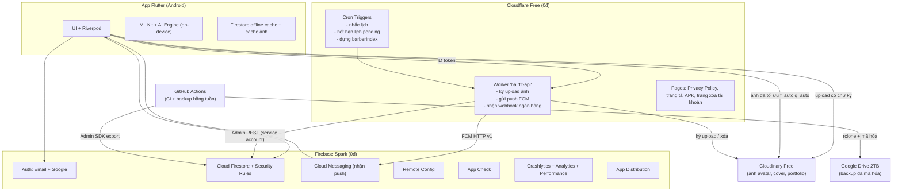

# HAIRFIT AI — KIẾN TRÚC CHI PHÍ 0Đ (ZERO-COST ARCHITECTURE)

> **Tài liệu bổ sung cho:** [HairFit_AI_Architecture_Review_And_Roadmap.md](./HairFit_AI_Architecture_Review_And_Roadmap.md)  
> **Ngày:** 2026-10-04  
> **Mục tiêu:** Vận hành pilot **5–20 salon, ≤ 1.000 khách** với **chi phí hạ tầng 0đ**, vẫn **bảo mật** và **mượt**.  
> **Quyết định đã chốt với chủ dự án:**
> - Dùng thêm dịch vụ miễn phí ngoài Firebase: **Cloudflare Workers, Cloudinary, GitHub Actions** (OneSignal là phương án dự phòng).
> - Phân phối pilot: **Firebase App Distribution / APK trực tiếp** (không Google Play).
> - Gói Firebase: chủ dự án chưa chắc → tài liệu so sánh ở **mục 2** và **khuyến nghị Spark**.

---

## 0. HƯỚNG DẪN CHO AI AGENT

1. Tài liệu này **ghi đè** một số task trong Roadmap. Xem bảng **mục 9 — Ánh xạ với Roadmap** trước khi làm bất kỳ task nào trùng chủ đề.
2. Task trong tài liệu này có tiền tố **`ZC-`** (Zero Cost). Cấu trúc mỗi task giống Roadmap: Mục tiêu → Thiết kế → Các bước → Nghiệm thu.
3. Quy tắc mục 0.2 và Definition of Done (Phụ lục C) của Roadmap **vẫn áp dụng**.
4. Quy tắc riêng cho kiến trúc 0đ:
   - Mọi tính năng mới phải ghi **ước lượng tiêu thụ quota** (đọc/ghi Firestore, request Worker, credit Cloudinary) trong mô tả PR.
   - **Cấm** đặt bất kỳ secret nào (service account, Cloudinary API secret, SePay token) trong app Flutter. Secret chỉ nằm ở **Cloudflare Worker secrets** hoặc **GitHub Secrets**.
   - Worker dùng service account → **bỏ qua Security Rules**. Vì vậy mọi endpoint của Worker phải tự kiểm tra quyền (xác thực ID token + kiểm tra quan hệ sở hữu dữ liệu).

---

## 1. SỰ THẬT CẦN BIẾT TRƯỚC

### 1.1 Google One Pro không trả tiền Firebase
Gói **Google One Pro / Google AI Pro** gồm dung lượng Drive 2TB + Gemini. Nó **không** kèm credit Google Cloud/Firebase và **không** chi trả hóa đơn Blaze. Cách tận dụng hợp lý:

| Tài nguyên Google One | Dùng vào việc gì trong dự án |
|---|---|
| Google Drive 2TB | Lưu **bản backup Firestore đã mã hóa** hằng tuần (ZC-08), lưu tài liệu thiết kế, ảnh gốc để hiệu chỉnh AI (không commit lên Git) |
| Gemini | Trợ lý viết code/test, soạn Privacy Policy, viết nội dung hướng dẫn cho salon |

### 1.2 Những thứ KHÔNG thể 0đ (cần biết để không bất ngờ)
| Hạng mục | Chi phí | Ghi chú |
|---|---|---|
| Google Play Console | 25 USD (1 lần) | Không cần cho pilot (dùng App Distribution) — cần khi phát hành rộng |
| Apple Developer Program | 99 USD/năm | **Bắt buộc** để phân phối iOS (TestFlight/App Store). Không có cách 0đ hợp lệ cho iOS ngoài cài lên máy của chính bạn (hết hạn sau 7 ngày) |
| Phone OTP (SMS) | Tính phí theo SMS, cần Blaze | Thay bằng **Google Sign-In + Email** (miễn phí) |
| Cổng thanh toán VNPay/MoMo | Phí giao dịch + cần pháp nhân/merchant | Pilot dùng **VietQR** (miễn phí) |
| Tên miền riêng | ~250k–400k/năm | Không cần: dùng `*.workers.dev`, `*.pages.dev`, `*.github.io` miễn phí |

---

## 2. SO SÁNH: SPARK hay BLAZE "GIỮ TRONG FREE TIER"?

| Tiêu chí | **Spark (khuyến nghị)** | Blaze + free tier |
|---|---|---|
| Gắn thẻ thanh toán | Không | Có |
| Trường hợp xấu nhất khi có bug/tấn công | **Hết quota → app tạm ngừng đến 7h sáng hôm sau (giờ VN)**. Không mất tiền | **Phát sinh hóa đơn**. Budget alert chỉ gửi email, **không tự chặn chi tiêu** |
| Cloud Functions, Storage, Phone OTP | Không có | Có (Functions & Storage có free tier) |
| Cách bù phần thiếu | Cloudflare Worker + Cloudinary + GitHub Actions (đều miễn phí, không cần thẻ) | Dùng trực tiếp dịch vụ Firebase |
| Độ phức tạp | Thêm 1 nền tảng (Cloudflare) phải vận hành | Ít nền tảng hơn |
| "Kill switch" tự ngắt billing | Không cần | Phải tự dựng: Budget → Pub/Sub → Function tắt billing (nếu cấu hình sai vẫn có thể mất tiền) |

> [!IMPORTANT]
> **Khuyến nghị: Spark + Cloudflare Worker cho pilot.** Với người làm một mình và yêu cầu "0đ tuyệt đối", rủi ro lớn nhất là **hóa đơn bất ngờ** do một vòng lặp listener lỗi. Spark biến rủi ro tiền bạc thành rủi ro "tạm ngừng dịch vụ" — dễ chấp nhận hơn nhiều. Chỉ cân nhắc Blaze khi qua Decision Gate (Roadmap mục 7.1) và có doanh thu.

> [!NOTE]
> Quota Firestore Spark reset theo giờ Thái Bình Dương (nửa đêm PT ≈ 14h–15h giờ VN tùy mùa). Agent không được hardcode giờ reset; chỉ cần biết quota là **theo ngày**.

---

## 3. KIẾN TRÚC TỔNG THỂ 0Đ



### 3.1 Phân vai rõ ràng
| Thành phần | Được làm | Không được làm |
|---|---|---|
| App Flutter | Đọc/ghi Firestore theo Rules, transaction đặt lịch, AI on-device | Giữ secret, gửi push cho người khác, ghi trạng thái thanh toán tự động |
| Firestore Rules | Nguồn sự thật về phân quyền cho client | — |
| Cloudflare Worker | Việc **cần secret** hoặc **cần chạy khi app tắt** | Thay thế toàn bộ backend (giữ Worker mỏng, dưới ~10ms CPU/request) |
| GitHub Actions | CI, backup, script bảo trì | Việc cần độ trễ thấp (cron GitHub có thể trễ 5–30 phút) |

---

## 4. NGÂN SÁCH QUOTA (QUOTA BUDGET)

### 4.1 Hạn mức miễn phí (kiểm tra lại trên trang chính thức trước khi go-live)
| Dịch vụ | Hạn mức free | Ngưỡng cảnh báo nội bộ (70%) |
|---|---|---|
| Firestore đọc | 50.000/ngày | 35.000 |
| Firestore ghi | 20.000/ngày | 14.000 |
| Firestore xóa | 20.000/ngày | 14.000 |
| Firestore lưu trữ | 1 GiB | 700 MiB |
| Firestore băng thông ra | 10 GiB/tháng | 7 GiB |
| Cloudflare Worker | 100.000 request/ngày, 10ms CPU/request, 3 cron/Worker | 70.000 |
| Cloudflare KV | 100.000 đọc/ngày, **1.000 ghi/ngày** | Hạn chế ghi KV |
| Cloudinary | 25 credit/tháng (1 credit ≈ 1GB lưu trữ **hoặc** 1GB băng thông **hoặc** 1.000 transformation) | 17 credit |
| GitHub Actions | Không giới hạn với repo public; 2.000 phút/tháng với repo private | 1.400 phút |
| FCM, Auth Email/Google, Crashlytics, Analytics, Remote Config, App Check, App Distribution | Miễn phí | — |

### 4.2 Ước lượng cho pilot (20 salon, 1.000 khách, ~300 người dùng hoạt động/ngày)

**Trước tối ưu** (code hiện tại — stream toàn bộ thợ, đọc `users` cho từng thợ, slot đọc appointments):
| Hành động | Đọc/lượt | Lượt/ngày | Tổng |
|---|---|---|---|
| Mở Home + Map (stream 20 thợ + 20 lần đọc `users` lấy avatar) | ~40 | 600 | 24.000 |
| Xem chi tiết thợ + review | ~15 | 400 | 6.000 |
| Màn đặt lịch (appointments + bookedSlots) | ~30 | 200 | 6.000 |
| Stream lịch hẹn, chat | ~30 | 400 | 12.000 |
| **Tổng** | | | **~48.000 → sát trần 50.000** |

**Sau tối ưu** (ZC-01 → ZC-03):
| Hành động | Đọc/lượt | Lượt/ngày | Tổng |
|---|---|---|---|
| Home + Map: **1 doc `barberIndex`**, chỉ tải lại khi version đổi | ~1–2 | 600 | 1.200 |
| Chi tiết thợ (doc + 10 review, cache) | ~11 | 400 | 4.400 |
| Đặt lịch (chỉ `bookedSlots` của 1 ngày) | ~8 | 200 | 1.600 |
| Lịch hẹn (giới hạn 20, chỉ lịch sắp tới realtime), chat (30 tin) | ~20 | 400 | 8.000 |
| Worker cron (nhắc lịch, hết hạn, dựng index) | — | — | ~3.000 |
| **Tổng** | | | **~18.000 (≈36% quota)** |

> [!TIP]
> Mục tiêu thiết kế: **dùng ≤ 40% quota trong ngày bình thường** để có dư địa cho ngày cao điểm (cuối tuần, lễ Tết) và cho các lần reconnect của listener.

---

## 5. NHÓM TASK A — TIẾT KIỆM QUOTA & MƯỢT HƠN

### ZC-01 · `barberIndex`: 1 lần đọc thay cho N lần đọc
- **Vấn đề:** Màn Home/Map đọc toàn bộ `barberProfiles` (mỗi doc chứa services, workingHours, exceptions…) + N lần đọc `users`.
- **Thiết kế:** Doc tổng hợp `meta/barberIndex`:
  ```json
  {
    "version": 42,
    "updatedAt": "Timestamp",
    "items": [
      { "id": "uid1", "n": "Barber Minh", "lat": 16.05, "lng": 108.2,
        "pMin": 70000, "pMax": 150000, "rs": 46, "rc": 10,
        "hs": ["undercut", "fade"], "img": "cloudinary_public_id", "addr": "123 Nguyễn Văn Linh" }
    ]
  }
  ```
  - Tên field ngắn để giảm dung lượng (~300 byte/thợ → 200 thợ ≈ 60KB, dưới giới hạn 1 MiB).
  - Chỉ chứa thợ `approvalStatus == 'approved' && isVisible == true`.
- **Ai cập nhật:** Worker (cron 15 phút + endpoint `POST /v1/index/rebuild` gọi ngay sau khi admin duyệt/khóa hoặc thợ lưu hồ sơ). Worker đọc toàn bộ `barberProfiles` approved và ghi đè `meta/barberIndex` với `version + 1`.
- **Client:**
  1. Lưu index vào bộ nhớ cục bộ (file JSON) kèm `version`.
  2. Mở app: đọc `meta/barberIndex` bằng `get()` (không stream). Nếu `version` không đổi → dùng cache (Firestore vẫn tính 1 lần đọc, chấp nhận được).
  3. Màn chi tiết thợ mới đọc `barberProfiles/{id}` đầy đủ.
- **Rules:** `match /meta/{docId} { allow read: if true; allow write: if false; }` (chỉ Worker ghi qua service account).
- **Nghiệm thu:** Mở Home + Map → Firestore usage tăng ≤ 2 lượt đọc; danh sách thợ hiển thị dưới 300ms khi đã có cache.

### ZC-02 · Kỷ luật listener & bộ nhớ đệm Firestore
- **Quy tắc bắt buộc:**
  1. **Chỉ dùng `snapshots()` cho dữ liệu cần realtime thật:** lịch hẹn sắp tới của chính mình, phòng chat đang mở, `bookedSlots` của ngày đang xem. Mọi thứ khác dùng `get()`.
  2. Mọi query danh sách phải có `limit()` (mặc định 20, chat 30) và phân trang `startAfterDocument`.
  3. Tách lịch hẹn: "Sắp tới" (stream, `where startTimestamp >= now`, `limit 20`) và "Lịch sử" (`get()` phân trang).
  4. Hủy listener khi rời màn hình (dùng `autoDispose` của Riverpod cho mọi `StreamProvider`).
  5. Bật cache: `FirebaseFirestore.instance.settings = const Settings(persistenceEnabled: true, cacheSizeBytes: 50 * 1024 * 1024);`
  6. Catalog kiểu tóc, cấu hình: đọc `Source.cache` trước, chỉ gọi server khi version đổi (xem Roadmap P1-10).
- **Rules ép giới hạn query (chống bị "đọc vét" quota):**
  ```js
  // ví dụ trong match /appointments/{id}
  allow list: if request.query.limit <= 50 && (resource.data.customerId == uid() || resource.data.barberId == uid());
  allow get: if isCustomer() || isBarber() || isAdmin();
  ```
  Áp dụng tương tự cho `reviews`, `chats/*/messages`, `bookedSlots` (`limit <= 60`).
- **Nghiệm thu:** Có bảng "listener đang mở theo màn hình" trong PR; Firestore usage trong ngày test thủ công giảm ≥ 50% so với trước.

### ZC-03 · Tách dữ liệu công khai & riêng tư (doc nhỏ = đọc nhanh, ít băng thông)
- `barberProfiles/{id}`: chỉ dữ liệu công khai cho khách (tên, địa chỉ, services, giờ làm, ảnh, rating).
- `barberPrivate/{id}`: dữ liệu riêng của thợ (thông tin ngân hàng cho VietQR, cấu hình webhook, ghi chú nội bộ). Rules: chỉ chủ và admin đọc. (Mã QR cho khách được Worker/khách tạo từ số tài khoản → số tài khoản ngân hàng **vốn phải lộ** cho người chuyển khoản; vẫn tách để không hiển thị cho người chưa đặt lịch.)
- Không lưu ảnh base64 trong doc (thay bằng Cloudinary — ZC-05).
- **Nghiệm thu:** Doc `barberProfiles` < 10KB.

### ZC-04 · Hiệu năng giao diện & kích thước app
| # | Việc | Chi tiết |
|---|---|---|
| 1 | Khởi động nhanh | `main()` chỉ `await` Firebase init. Remote Config fetch, tải index, probe tile chạy **sau** khi vẽ frame đầu (`WidgetsBinding.instance.addPostFrameCallback`). Mục tiêu cold start < 2s trên máy tầm trung |
| 2 | Ảnh | Mọi ảnh mạng qua `cached_network_image` với URL Cloudinary có `w_<kích thước hiển thị * devicePixelRatio>`, `f_auto`, `q_auto`. Đặt `memCacheWidth` tương ứng |
| 3 | Danh sách | Chỉ dùng `ListView.builder`/`SliverList`; tách widget con `const`; màn > 300 dòng phải tách file (Roadmap Q-01) |
| 4 | Bản đồ | Cluster marker khi > 30 thợ; marker là widget nhẹ (không ảnh mạng trong marker, ảnh chỉ ở bottom sheet) |
| 5 | Tile bản đồ | Cache tile trên đĩa bằng `flutter_map_cache` + `dio_cache_interceptor` (giấy phép MIT). **Tránh** `flutter_map_tile_caching` vì giấy phép GPL-3 |
| 6 | AI | Ảnh đầu vào resize ≤ 1024px trước khi đưa ML Kit; dùng `FaceDetectorMode.fast` cho preview, `accurate` cho ảnh chốt |
| 7 | Kích thước APK | `flutter build apk --release --split-per-abi --obfuscate --split-debug-info=build/symbols`; xóa package không dùng (`http` nếu thay bằng `dio`, `flutter_dotenv`) |
| 8 | Đo lường | Bật **Firebase Performance Monitoring** (miễn phí): trace `ai_analysis`, `booking_transaction`, `home_first_paint` |
- **Nghiệm thu:** APK arm64 < 30MB; trace `home_first_paint` p90 < 1.5s trên máy pilot.

---

## 6. NHÓM TASK B — CLOUDFLARE WORKER "HAIRFIT-API"

### ZC-05 · Dựng Worker nền tảng (xác thực + truy cập Firestore + an toàn)
- **Vị trí code:** `backend/worker/` (TypeScript, `wrangler`, test bằng `vitest` + Miniflare). Không cần thẻ thanh toán.
- **Cấu trúc:**
  ```text
  backend/worker/
  ├── src/
  │   ├── index.ts              # router (fetch + scheduled)
  │   ├── auth/verifyIdToken.ts # xác thực Firebase ID token
  │   ├── google/accessToken.ts # đổi service account → OAuth token (cache 50 phút)
  │   ├── google/firestore.ts   # wrapper Firestore REST (get, runQuery, commit có precondition)
  │   ├── google/fcm.ts         # FCM HTTP v1
  │   ├── routes/*.ts           # mỗi endpoint 1 file
  │   └── cron/*.ts             # nhắc lịch, hết hạn, rebuild index
  ├── test/
  └── wrangler.toml
  ```
- **Xác thực người gọi:** App gửi `Authorization: Bearer <Firebase ID token>` (+ header `X-Firebase-AppCheck` khi bật App Check). Worker:
  1. Lấy JWKS từ `https://www.googleapis.com/service_accounts/v1/jwk/securetoken@system.gserviceaccount.com` (cache theo `Cache-Control`).
  2. Kiểm tra chữ ký RS256 (thư viện `jose`), `aud == <projectId>`, `iss == https://securetoken.google.com/<projectId>`, `exp`, `auth_time`.
  3. Nếu có App Check token: xác thực tương tự với JWKS `https://firebaseappcheck.googleapis.com/v1/jwks`, `aud` chứa `projects/<projectNumber>`.
- **Service account riêng cho Worker** (tạo trong Google Cloud Console của project Spark, **không cần Blaze**):
  - Quyền tối thiểu: `Cloud Datastore User` + `Firebase Cloud Messaging API Admin`.
  - Lưu bằng `wrangler secret put GCP_SA_KEY` (JSON). **Không** đưa vào `wrangler.toml`.
  - Đổi khóa 6 tháng/lần; ghi lịch trong `docs/ops/runbook.md`.
- **An toàn bắt buộc:**
  - CORS: chỉ cho phép gốc web của dự án (app di động không cần CORS).
  - Mọi body validate bằng schema (`zod` hoặc kiểm tra thủ công) — từ chối field lạ.
  - Giới hạn tần suất đơn giản theo `uid` (bộ nhớ trong isolate + kiểm tra cờ idempotent ở Firestore). **Không** ghi KV mỗi request (KV free chỉ 1.000 ghi/ngày).
  - Không log ID token, số tài khoản, nội dung tin nhắn.
  - Trả lỗi dạng `{ "error": { "code": "permission_denied", "message": "..." } }`.
- **Client Flutter:** `lib/core/api/worker_client.dart` — tự gắn ID token (`getIdToken()`), App Check token, timeout 10s, retry 1 lần với lỗi mạng. URL Worker lấy từ Remote Config/`--dart-define`.
- **Nghiệm thu:** Gọi endpoint không token → 401; token của project khác → 401; test đơn vị cho `verifyIdToken` với token giả lập pass; CPU trung bình < 5ms/request (xem Cloudflare dashboard).

### ZC-06 · Push notification thật qua FCM (thay Roadmap P1-03 & P2-02)
- **Lưu token thiết bị:** client ghi `users/{uid}/devices/{installationId}` = `{ token, platform, appVersion, updatedAt }` (Rules: chỉ chủ ghi/đọc). Cập nhật khi `onTokenRefresh`.
- **Kích hoạt (Spark không có Firestore trigger):** sau khi transaction thành công, client gọi Worker:
  `POST /v1/notify/appointment` body `{ "appointmentId": "...", "event": "created|confirmed|rejected|cancelled|completed" }`
- **Worker xử lý:**
  1. Đọc `appointments/{id}` bằng REST.
  2. Kiểm tra người gọi đúng là **người vừa thực hiện hành động** (vd. `created` → `uid == customerId`; `confirmed` → `uid == barberId`) và trạng thái hiện tại **khớp** `event` (không cho gửi thông báo giả).
  3. Idempotent: nếu `notified.<event> == true` → trả 200, không gửi lại. Ngược lại gửi FCM tới các device của người nhận rồi ghi `notified.<event> = true` bằng `commit` có precondition `updateTime`.
  4. Token lỗi `UNREGISTERED` → xóa doc device tương ứng.
- **Rules:** trường `notified` chỉ Worker ghi → thêm `'notified'` vào danh sách field client không được sửa trong mọi nhánh `update` của appointments.
- **Nếu client gọi Worker thất bại** (mất mạng ngay sau khi đặt): cron ZC-07 quét lịch `pending` có `notified.created != true` và gửi bù.
- **Nội dung thông báo:** không chứa ghi chú của khách; chỉ "Bạn có lịch mới lúc 09:00 ngày 10/10".
- **Phương án dự phòng:** OneSignal (free) nếu FCM HTTP v1 qua Worker gặp trở ngại — nhưng vẫn phải gửi qua Worker (REST API key của OneSignal là secret).
- **Nghiệm thu:** App thợ đã tắt hẳn vẫn nhận thông báo lịch mới trong < 10 giây.

### ZC-07 · Cron Triggers: nhắc lịch, hết hạn, dựng index
`wrangler.toml`:
```toml
[triggers]
crons = ["*/5 * * * *", "*/15 * * * *"]
```
| Cron | Việc | Truy vấn (Firestore REST `runQuery`) |
|---|---|---|
| `*/5` | **Nhắc lịch T-60'** cho khách | `status == confirmed && startTimestamp in [now+55', now+65'] && reminded60 != true` → gửi FCM, ghi `reminded60 = true` |
| `*/5` | **Gửi bù** thông báo lịch mới | `status == pending && notified.created != true && createdAt < now-2'` |
| `*/15` | **Hết hạn lịch pending** (thay "hết hạn lười" của Roadmap P1-02) | `status == pending && startTimestamp < now` → `status = expired` |
| `*/15` | **Rebuild `meta/barberIndex`** nếu có thợ `updatedAt > index.updatedAt` | Đọc 1 doc index + query `updatedAt >` → chỉ dựng lại khi cần |
- Thêm index Firestore cho các query trên (`status + startTimestamp`).
- Mỗi lần cron giới hạn xử lý 50 doc; dư thì lần sau xử lý tiếp (tránh vượt 10ms CPU — thời gian chờ mạng không tính CPU).
- **Nghiệm thu:** Lịch `confirmed` lúc 10:00 → khách nhận nhắc trong khoảng 08:55–09:05; lịch `pending` quá giờ chuyển `expired` trong ≤ 15 phút.

### ZC-08 · Ảnh qua Cloudinary với upload có chữ ký (thay Roadmap P0-06)
- **Vì sao Cloudinary:** free không cần thẻ, có CDN, tự chuyển WebP/AVIF (`f_auto`), tự nén (`q_auto`), resize theo URL → app mượt và tiết kiệm băng thông Firestore.
- **Luồng upload:**
  1. App chọn ảnh, nén sơ bộ (avatar ≤ 512px, cover/portfolio ≤ 1280px).
  2. App gọi `POST /v1/media/sign` `{ "kind": "avatar|cover|portfolio" }`.
  3. Worker xác thực, tạo `public_id` cố định theo quyền: `hairfit/<env>/<kind>/<uid>` (avatar/cover) hoặc `hairfit/<env>/portfolio/<uid>/<random>`; ký `timestamp + public_id + folder + overwrite + allowed_formats` bằng `CLOUDINARY_API_SECRET` → trả `{ signature, timestamp, apiKey, publicId, cloudName }`.
  4. App upload thẳng lên Cloudinary bằng chữ ký đó (Worker không chuyển tiếp file → tiết kiệm CPU).
  5. App ghi `public_id` + `imageVersion` vào Firestore (Rules kiểm tra `public_id` bắt đầu bằng `hairfit/<env>/avatar/<uid>`).
- **Hiển thị:** `https://res.cloudinary.com/<cloud>/image/upload/f_auto,q_auto,w_256,c_fill,g_face/v<version>/<public_id>`
  (`g_face` tự căn giữa khuôn mặt cho avatar).
- **Xóa:** `POST /v1/media/delete` — Worker chỉ cho xóa `public_id` thuộc `uid` người gọi. Gọi khi xóa tài khoản (Roadmap P1-05).
- **Cấu hình Cloudinary:** tắt unsigned upload; giới hạn định dạng `jpg,png,webp`; giới hạn kích thước file 5MB; bật "strict transformations" nếu cần chặn người lạ tạo biến thể tùy ý (tốn credit).
- **Giới hạn pilot:** tối đa 6 ảnh portfolio/thợ.
- **Ảnh AI khuôn mặt của khách:** **không bao giờ** upload — chỉ xử lý on-device (giữ nguyên cam kết quyền riêng tư).
- **Migration:** script `tools/migrate/base64_to_cloudinary.ts` (chạy local, dùng Admin SDK + Cloudinary Admin API).
- **Nghiệm thu:** Doc Firestore không còn base64; avatar tải < 30KB/ảnh; người dùng A không thể ghi đè ảnh của B (test cả Worker lẫn Rules).

### ZC-09 · (Tùy chọn theo salon) Tự xác nhận cọc VietQR qua webhook ngân hàng
- Mở rộng Roadmap P1-07. Dịch vụ như **SePay** có gói miễn phí giới hạn (hiện ~50 giao dịch/tháng/tài khoản — kiểm tra lại) và gửi webhook khi tài khoản nhận tiền.
- **Mô hình:** mỗi salon tự đăng ký SePay cho tài khoản của mình (tiền đi thẳng vào tài khoản salon, dự án **không** giữ tiền → tránh rủi ro pháp lý trung gian thanh toán).
- Salon dán **webhook URL** `https://<worker>/v1/webhooks/bank/<barberId>` và một **API key** riêng vào cấu hình; Worker lưu hash API key trong `barberPrivate/{id}.bankWebhookKeyHash`.
- Worker nhận webhook → kiểm tra API key → tìm nội dung chứa `transferCode` (vd. `HF8K2P9A`) → khớp số tiền → cập nhật `deposit.status = 'received'` (idempotent theo mã giao dịch ngân hàng) → gửi push cho khách và thợ.
- Salon không dùng SePay → vẫn bấm "Đã nhận cọc" thủ công.
- **Nghiệm thu:** Chuyển khoản thử 2.000đ đúng nội dung → lịch tự chuyển "Đã cọc" trong < 30 giây.

---

## 7. NHÓM TASK C — BẢO MẬT KHÔNG TỐN TIỀN

### ZC-10 · Lớp chống lạm dụng quota (trên Spark, "tấn công" = làm sập app)
| # | Biện pháp | Chi tiết |
|---|---|---|
| 1 | **Bắt buộc email đã xác minh** để đặt lịch/chat/review | Rules: `request.auth.token.email_verified == true` (Google Sign-In mặc định đã xác minh). Chặn tạo hàng loạt tài khoản rác |
| 2 | **Giới hạn query trong Rules** | `request.query.limit <= N` (ZC-02) |
| 3 | **Giới hạn kích thước field** | Mọi chuỗi có `.size() <= N`; mảng có `.size() <= N` |
| 4 | **Chỉ cho đọc `bookedSlots` theo 1 thợ + 1 ngày** | Rules `allow list: if request.query.limit <= 60` + client luôn lọc `barberId` & `date` |
| 5 | **App Check** | Xem ZC-11 |
| 6 | **Firebase Auth** | Bật *Email enumeration protection*, đặt *password policy* (≥ 8 ký tự, có chữ và số) |
| 7 | **Kill switch qua Remote Config** | `feature_booking_enabled`, `feature_chat_enabled`, `maintenance_message` → tắt nhanh tính năng bị lạm dụng không cần phát hành bản mới |

### ZC-11 · App Check khi phân phối ngoài Google Play
- **Thực tế:** App cài từ App Distribution/APK không được Google Play "nhận diện". Nếu bật yêu cầu *PLAY_RECOGNIZED/LICENSED* trong cấu hình Play Integrity, app pilot sẽ **bị chặn**.
- **Các bước:**
  1. Đăng ký SHA-256 của **keystore release tự quản** (không có Play App Signing khi chưa lên Play) trong Firebase.
  2. Dùng provider Play Integrity, **tắt** yêu cầu PLAY_RECOGNIZED/LICENSED; chỉ yêu cầu device integrity cơ bản.
  3. Bật App Check cho Firestore ở chế độ **Monitor** 1–2 tuần, xem tỷ lệ request hợp lệ. Chỉ **Enforce** khi tỷ lệ "verified" ≥ 98%.
  4. Debug build dùng Debug Provider; debug token lưu ngoài repo.
  5. Worker xác thực App Check token (ZC-05) — ban đầu chỉ log, sau đó bắt buộc cùng lúc với Firestore.
- **Nghiệm thu:** Có ghi chép tỷ lệ verified trong `docs/ops/runbook.md` trước khi enforce.

### ZC-12 · Vệ sinh secret & chuỗi cung ứng (miễn phí trên GitHub)
1. Bật **GitHub secret scanning + push protection**, **Dependabot alerts** (pub & npm).
2. CI chạy `gitleaks` để chặn commit lộ khóa.
3. `.gitignore` bổ sung: `*.jks`, `*.keystore`, `key.properties`, `service-account*.json`, `.dev.vars` (secret local của wrangler).
4. Keystore release + mật khẩu: lưu **2 bản** — trình quản lý mật khẩu và Google Drive (file nén có mật khẩu). **Mất keystore = không cập nhật được app** cho người đã cài.
5. Tài khoản Firebase/Cloudflare/Cloudinary/GitHub: bật **xác thực 2 lớp**.

---

## 8. NHÓM TASK D — VẬN HÀNH 0Đ

### ZC-13 · Phân phối & cập nhật app không qua Store
- **Nhóm thợ/salon (tester):** Firebase App Distribution — gửi lời mời qua email, có thông báo bản mới.
- **Nhóm khách hàng:** Trang tải APK trên **Cloudflare Pages** (miễn phí) + mã QR dán tại salon. Trang có: hướng dẫn bật "Cài ứng dụng không rõ nguồn gốc", SHA-256 của APK để đối chiếu, link Privacy Policy.
- **Cập nhật trong app (thay cho Play auto-update):** Remote Config `min_supported_build`, `latest_build`, `apk_url`, `release_notes`.
  - `build < min_supported_build` → màn hình bắt buộc cập nhật.
  - `build < latest_build` → banner "Có bản mới".
- **Rủi ro cần nói rõ với chủ dự án:** Cài APK ngoài Store tạo cảm giác thiếu tin cậy với khách lạ và bị Google Play Protect cảnh báo. Khi pilot cần mở rộng sang khách không quen → đầu tư 25 USD lên Google Play (Decision D-7).
- **Nghiệm thu:** Tăng `min_supported_build` → bản cũ hiện màn hình bắt buộc cập nhật kèm link tải.

### ZC-14 · CI/CD miễn phí với GitHub Actions
| Workflow | Kích hoạt | Việc |
|---|---|---|
| `ci.yml` | Pull request | format, analyze, test Flutter; test Rules trên Emulator; test Worker (vitest); gitleaks |
| `release.yml` | Tag `v*` | Build APK release (keystore giải mã từ GitHub Secrets) → upload Firebase App Distribution (`firebase appdistribution:distribute` bằng service account) → tạo GitHub Release đính kèm APK → cập nhật trang tải trên Pages |
| `worker-deploy.yml` | Push vào `main` thay đổi `backend/worker/**` | `wrangler deploy` (token Cloudflare trong Secrets) |
| `rules-deploy.yml` | Push vào `main` thay đổi `firestore.rules`/`firestore.indexes.json` | Chạy test rules → `firebase deploy --only firestore` |
| `backup.yml` | Cron hằng tuần (Chủ nhật 02:00 VN) + chạy tay | Xem ZC-15 |
- **Lưu ý:** Workflow `schedule` có thể bị trễ và tự tắt nếu repo **public** không có hoạt động 60 ngày → giữ việc cần đúng giờ (nhắc lịch) ở **Cloudflare Cron**, không ở GitHub.

### ZC-15 · Backup mã hóa lên Google Drive 2TB
1. Script `tools/backup/export.ts` (Admin SDK): xuất các collection chính ra JSON Lines, nén `.tar.gz`.
2. Mã hóa bằng `age` (khóa công khai trong repo, khóa bí mật **chỉ** giữ offline bởi chủ dự án).
3. Upload lên thư mục Drive riêng bằng `rclone` (OAuth token của tài khoản Google One lưu trong GitHub Secrets, scope chỉ `drive.file`).
4. Giữ 8 bản gần nhất (xóa bản cũ hơn).
5. **Diễn tập khôi phục** mỗi tháng vào project **dev**: `tools/backup/restore.ts`. Ghi kết quả vào runbook.
- **Chi phí quota:** 1 lần backup ≈ số doc hiện có (vài nghìn lượt đọc) — chạy cuối tuần, lúc ít người dùng.
- **Nghiệm thu:** Có 1 lần khôi phục thành công vào project dev, dữ liệu khớp số lượng doc.

### ZC-16 · Giám sát sức khỏe hệ thống 0đ
| Cần biết | Công cụ miễn phí |
|---|---|
| App có crash không | Crashlytics (bật cảnh báo email cho crash mới) |
| Màn nào chậm | Performance Monitoring |
| Quota Firestore | Firebase Console → Usage (kiểm tra **hằng ngày** trong 2 tuần đầu pilot, sau đó hằng tuần) |
| Worker lỗi | Cloudflare dashboard (Workers → Logs/Analytics); bật thông báo email khi lỗi tăng |
| Worker còn sống | Cron `*/15` ghi `meta/health.workerLastRun`; app admin hiển thị "Worker hoạt động X phút trước" (đỏ nếu > 30 phút) |
| Funnel nghiệp vụ | Analytics (các event ở Roadmap P0-10) |
- **Runbook** `docs/ops/runbook.md` phải có: xử lý khi hết quota (bật `maintenance_message`, kiểm tra listener lỗi), khi Worker lỗi, khi lộ secret (thu hồi & xoay khóa), khi mất keystore (không thể — phải phòng ngừa).

---

## 9. ÁNH XẠ VỚI ROADMAP (ĐIỀU CHỈNH TASK CŨ)

| Task Roadmap | Thay đổi theo kiến trúc 0đ |
|---|---|
| P0-05 (dev/prod) | Giữ nguyên. Thêm: mỗi môi trường có Worker riêng (`hairfit-api-dev`, `hairfit-api-prod`) và folder Cloudinary riêng (`hairfit/dev`, `hairfit/prod`) |
| **P0-06** (ảnh base64 sang collection riêng) | **Thay bằng ZC-08** (Cloudinary). Không tạo collection `avatars/`, `covers/` |
| P0-08 (rating) | Giữ nguyên. `barberIndex` (ZC-01) đọc `ratingSum/ratingCount` |
| **P0-09** (phát hành Android) | Bỏ bước upload Google Play; App Check làm theo **ZC-11**; Google Sign-In đăng ký SHA của keystore tự quản |
| P0-10 (Crashlytics) | Giữ nguyên + thêm Performance Monitoring (ZC-04) |
| P1-02 (vòng đời lịch) | Hết hạn pending chuyển sang **cron Worker** (ZC-07); vẫn giữ nhánh rules "expired" cho client làm dự phòng |
| **P1-03** (thông báo local) | **Nâng cấp bằng ZC-06** (push thật). Giữ thông báo local làm dự phòng cho nhắc lịch khi máy không có mạng |
| P1-04 (admin) | Sau khi duyệt/khóa thợ → gọi `POST /v1/index/rebuild` |
| P1-05 (xóa tài khoản) | Thêm: gọi Worker xóa ảnh Cloudinary; trang hướng dẫn xóa tài khoản host trên Cloudflare Pages |
| P1-06 (Google Sign-In) | Giữ nguyên |
| P1-07 (VietQR) | Giữ nguyên + tùy chọn ZC-09 |
| P1-11 (CI & backup) | **Thay bằng ZC-14, ZC-15** |
| **P2-02** (Push FCM) | **Đã làm ở ZC-06** — không cần Blaze |
| P2-03 (cổng thanh toán) | Vẫn chờ (cần merchant/pháp nhân). Khi có, Worker nhận IPN thay cho Cloud Functions |
| P2-04 (Phone OTP) | **Loại khỏi phạm vi 0đ** |
| P2-06 (iOS) | **Không thể 0đ** (99 USD/năm). Giữ ở Phase 2 khi có ngân sách |
| Phụ lục A (rules) | Bổ sung: `meta/*` chỉ đọc; field `notified`, `reminded60` chỉ Worker ghi; `request.query.limit`; `email_verified`; bỏ `avatars/`, `covers/`; thêm `barberPrivate/{id}` và `users/{uid}/devices/{id}` |

### 9.1 Bổ sung Rules (dán vào Phụ lục A của Roadmap)
```js
// Dữ liệu do Worker quản lý: client chỉ đọc
match /meta/{docId} {
  allow read: if true;
  allow write: if false;
}

// Dữ liệu riêng của thợ
match /barberPrivate/{barberId} {
  allow read, write: if (signedIn() && uid() == barberId && active()) || isAdmin();
}

// Token thiết bị nhận push
match /users/{userId}/devices/{deviceId} {
  allow read, write: if signedIn() && uid() == userId;
}

// Trong match /appointments/{apptId}: thêm vào MỌI nhánh update của client
//   && !changed().hasAny(['notified', 'reminded60'])
// Và nhánh create:
//   && request.auth.token.email_verified == true
//   && !n().keys().hasAny(['notified', 'reminded60'])
```

---

## 10. THỨ TỰ THỰC HIỆN ĐỀ XUẤT

```mermaid
gantt
  title Lộ trình 0đ (1 dev) — tuần tương đối
  dateFormat  X
  axisFormat  T%s
  section Phase 0 (Roadmap)
  P0-00..P0-05 Rules, Booking, Timezone, Map, Env :a1, 0, 2
  ZC-05 Worker nền tảng                          :a2, 1, 1
  ZC-08 Ảnh Cloudinary (thay P0-06)              :a3, 2, 1
  P0-07..P0-10 Auth, Rating, Release, Crashlytics:a4, 2, 1
  ZC-10..ZC-12 Bảo mật 0đ                        :a5, 3, 1
  section Tối ưu
  ZC-01..ZC-04 Quota & hiệu năng                 :b1, 3, 1
  section Phase 1
  ZC-06, ZC-07 Push + Cron                       :c1, 4, 1
  P1-01, P1-02, P1-04 Walk-in, vòng đời, admin   :c2, 4, 2
  ZC-13..ZC-16 Phân phối, CI, backup, giám sát   :c3, 5, 1
  P1-05..P1-12 còn lại                           :c4, 6, 2
  ZC-09 Webhook cọc (tùy chọn)                   :c5, 7, 1
```



---

## 11. QUYẾT ĐỊNH CẦN CHỦ DỰ ÁN CHỐT (BỔ SUNG PHỤ LỤC E CỦA ROADMAP)

| # | Quyết định | Gợi ý |
|---|---|---|
| D-7 | Khi nào chi 25 USD lên Google Play? | Khi cần phục vụ khách **không quen** hoặc > 300 người cài |
| D-8 | Repo GitHub public hay private? | **Private** (code có cấu hình nghiệp vụ, tránh lộ endpoint Worker); 2.000 phút CI/tháng là đủ |
| D-9 | Ai giữ khóa giải mã backup & keystore? | Chủ dự án, lưu 2 nơi tách biệt |
| D-10 | Tài khoản Cloudflare/Cloudinary/Firebase đứng tên ai? | Dùng 1 email dự án riêng (không dùng email cá nhân), bật 2FA |
| D-11 | Có bật webhook cọc tự động (ZC-09) cho salon pilot không? | Thử với 1 salon trước |

---

## PHỤ LỤC — CÂU LỆNH MẪU GIAO VIỆC

```text
Đọc docs/HairFit_AI_Zero_Cost_Architecture.md (mục 0, mục 9) và task ZC-05.
Đọc thêm Roadmap mục 0.2 + Phụ lục C. Thực hiện DUY NHẤT ZC-05.
Trước khi code: liệt kê file sẽ tạo/sửa + ước lượng quota tiêu thụ.
Sau khi xong: báo cáo file đã đổi, test đã thêm, kết quả test, rủi ro còn lại,
và các bước thủ công chủ dự án phải làm (tạo service account, wrangler secret put...).
```
